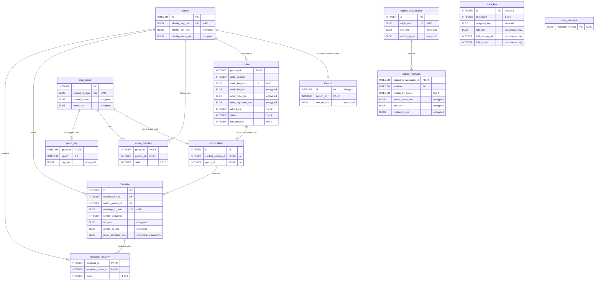

# P2PMessenger.Storage: the local database

Each device keeps its data in one SQLite database of its own. There is no server: contacts, keys and messages exist only on the devices of the people who use the app. The only data that leaves a device on purpose is a copy of chosen chats on the user's own PC, which that PC keeps in the `copied_conversation` and `copied_message` tables.

This file documents the database: the design rules, the logical schema, how stored data is protected, the data dictionary, normalisation, migrations, and how to create and inspect a database. The schema is created and changed only by the numbered scripts in [`Migrations`](Migrations); nothing is created by hand.

**Status:** the schema, the migration runner and their tests exist. The first working version of the app keeps its data in memory; a later milestone connects the app to this database and adds the encryption described in [How stored data is protected](#how-stored-data-is-protected).

## Contents

1. [Design rules](#design-rules)
2. [Logical schema](#logical-schema)
3. [How stored data is protected](#how-stored-data-is-protected)
4. [Data dictionary](#data-dictionary)
5. [Normalisation](#normalisation)
6. [Migrations](#migrations)
7. [Creating and inspecting a database](#creating-and-inspecting-a-database)

## Design rules

- **Engine:** SQLite through Microsoft.Data.Sqlite, which brings its own SQLite build (SQLitePCLRaw `e_sqlite3`), so Windows, Linux and Android run the same SQLite version.
- **Types are enforced:** every table is `STRICT`, so SQLite refuses a value of the wrong type, for example text in a `BLOB` column.
- **Keys:** an entity table has a surrogate key, `id INTEGER PRIMARY KEY` (SQLite's row ID). Tables that only connect or depend on other rows (`group_member`, `group_key`, `message_delivery`, `copied_message`, `seen_message`) use their natural key, composite where needed, and are `WITHOUT ROWID`. The two single-row tables (`data_key`, `identity`) allow only `id = 1`.
- **Foreign keys are enforced:** every connection is opened with `PRAGMA foreign_keys = ON`. `ON DELETE CASCADE` is used where a child row means nothing without its parent (the messages of a chat, the members and keys of a group); everywhere else the default, `NO ACTION`, refuses a delete that would leave rows without their parent.
- **Coded values** are small integers limited by `CHECK` constraints. The codes are listed with each column in the [data dictionary](#data-dictionary).
- **Encrypted values and MACs** are `BLOB` columns whose length is checked: an encrypted value has at least 40 bytes, a MAC exactly 32.
- **Connection settings:** besides foreign keys, every connection uses the `WAL` journal, so reading does not wait for writing, and `PRAGMA secure_delete = ON`, so SQLite overwrites deleted content with zeros and a deleted chat does not stay readable in free pages of the file. `SqliteDatabase.OpenAsync` sets all three.
- **Names:** `snake_case`, singular table names. A column ending in `_enc` is encrypted and one ending in `_mac` holds a MAC. `group` is an SQL keyword, so the group table is `chat_group`.

## Logical schema



The model in words:

- A **person** is anyone the app knows by an identity key: the user of this device (through `identity`), the user's contacts (through `contact`), and members of the user's groups whom the user has not added as contacts yet. Messages, group memberships and deliveries refer to persons, so the user and everyone else are handled the same way, and a group message keeps its author when the author is not, or no longer, a contact.
- A **contact** is a person whose contact code the user has added. A **chat** (`conversation`) belongs either to one contact or to one group, never both.
- A **group** (`chat_group`) has members (`group_member`) and one key per epoch (`group_key`). Removing a member starts a new epoch with a new key.
- A **message** belongs to a chat and has an author. For the user's own messages, `message_delivery` holds one state per recipient. The **outbox** is a view: the deliveries still waiting.
- `seen_message` remembers the IDs of received messages, and `data_key` holds the key that encrypts everything else. Both stand alone.
- `copied_conversation` and `copied_message` exist on the user's PC only: a read-only copy of chats from the user's phone, kept apart from the PC's own chats and not linked to its contacts.

## How stored data is protected

A copy of the database file must not reveal keys, contacts or messages on another device. Every column falls into one of four classes:

| Class | Columns | What is stored | Why |
| --- | --- | --- | --- |
| Plain | Keys, foreign keys, coded values, counters | The value itself | Carries the structure of the data; holds no names, keys, texts, addresses or times |
| Encrypted | Name ends in `_enc` | XChaCha20-Poly1305 under the data key: a 24-byte random nonce, the ciphertext and a 16-byte tag, so at least 40 bytes. The associated data names the table, the column and the row, so a value moved to another row or column does not decrypt | Names, keys, texts and times are unreadable without the data key |
| MAC | Name ends in `_mac` | Keyed BLAKE2b-256 of the value (32 bytes), under a key derived from the data key | Equal values give equal MACs, so the database can find a value and enforce `UNIQUE` without storing the value; without the key, a MAC reveals nothing about it |
| Wrapped | `data_key.wrapped_key` | The data key, encrypted by a key derived from the user's passphrase or by the platform's key store | Without the passphrase, or on another device, the data key cannot be recovered |

The data key is 32 random bytes made on the device. It is never stored unwrapped, and every `_enc` and `_mac` value depends on it. Plain columns still show how many contacts, chats and messages there are and which rows refer to which; they show no content.

## Data dictionary

Column **Key**: PK primary key, FK foreign key, UK unique. **Class**: see [How stored data is protected](#how-stored-data-is-protected). Every table is `STRICT`.

### `data_key`

The data key that encrypts every `_enc` column, wrapped by a passphrase or by the platform's key store. One row.

| Column | Type | Null | Key | Class | Description |
| --- | --- | --- | --- | --- | --- |
| `id` | INTEGER | No | PK | Plain | Always 1 (`CHECK (id = 1)`) |
| `protection` | INTEGER | No | | Plain | What wraps the data key: 1 = a key derived from the user's passphrase with Argon2id, 2 = Windows DPAPI (current user), 3 = Android Keystore, 4 = Linux Secret Service |
| `wrapped_key` | BLOB | No | | Wrapped | The wrapped data key; not empty |
| `kdf_salt` | BLOB | Yes | | Plain | Argon2id salt, 16 bytes |
| `kdf_memory_kib` | INTEGER | Yes | | Plain | Argon2id memory cost in KiB, above 0 |
| `kdf_passes` | INTEGER | Yes | | Plain | Argon2id number of passes, above 0 |

Constraint: the three `kdf_` columns are all set when `protection = 1` and all NULL otherwise.

### `person`

Everyone the app knows by an identity key: the user of this device, the user's contacts, and group members not added as contacts yet.

| Column | Type | Null | Key | Class | Description |
| --- | --- | --- | --- | --- | --- |
| `id` | INTEGER | No | PK | Plain | Surrogate key |
| `identity_key_mac` | BLOB | No | UK | MAC | MAC of the person's Ed25519 identity public key; finds a person by key and keeps one row per person |
| `identity_key_enc` | BLOB | No | | Encrypted | The Ed25519 identity public key (32 bytes), which checks the person's signatures |
| `display_name_enc` | BLOB | No | | Encrypted | The display name: for a contact, the name signed in their contact code; for another group member, the name the group gave |

### `identity`

The user of this device: their person row and their private keys. One row.

| Column | Type | Null | Key | Class | Description |
| --- | --- | --- | --- | --- | --- |
| `id` | INTEGER | No | PK | Plain | Always 1 (`CHECK (id = 1)`) |
| `person_id` | INTEGER | No | FK `person.id`, UK | Plain | The user's own person row, with their identity key and name |
| `key_set_enc` | BLOB | No | | Encrypted | The user's private keys: the identity, static and onion-service keys (97 bytes before encryption). They never leave the device |

### `contact`

A person the user has added by exchanging contact codes. With `person.identity_key_enc` and `person.display_name_enc`, these columns rebuild the person's contact code byte for byte.

| Column | Type | Null | Key | Class | Description |
| --- | --- | --- | --- | --- | --- |
| `person_id` | INTEGER | No | PK, FK `person.id` | Plain | The person; deleting the person deletes the contact |
| `code_version` | INTEGER | No | | Plain | Format version of the contact code; 1 is the only version so far |
| `static_key_mac` | BLOB | No | UK | MAC | MAC of the X25519 static key; no two contacts share a static key |
| `static_key_enc` | BLOB | No | | Encrypted | The X25519 static public key, used to set up encrypted sessions with the contact |
| `onion_key_enc` | BLOB | No | | Encrypted | The public key of the contact's Tor onion service; the onion address is computed from it |
| `code_signature_enc` | BLOB | No | | Encrypted | The identity key's signature over the contact code |
| `added_via` | INTEGER | No | | Plain | How the codes were exchanged: 1 = in person, scanning each other's QR codes; 2 = through another channel (a text, file or QR image sent in another messenger) |
| `status` | INTEGER | No | | Plain | 1 = waiting for the first connection, in which the contact's app proves that it holds the private keys; 2 = confirmed |
| `key_checked` | INTEGER | No | | Plain | 1 when the user compared fingerprints and marked the key as checked, otherwise 0 (default 0) |

### `chat_group`

A small group of contacts.

| Column | Type | Null | Key | Class | Description |
| --- | --- | --- | --- | --- | --- |
| `id` | INTEGER | No | PK | Plain | Surrogate key |
| `shared_id_mac` | BLOB | No | UK | MAC | MAC of the group's ID; finds the group of an incoming group message |
| `shared_id_enc` | BLOB | No | | Encrypted | The group's random ID, the same on every member's device and carried in group messages |
| `name_enc` | BLOB | No | | Encrypted | The group's name |

### `group_member`

Who is, or was, in a group, the user included. `WITHOUT ROWID`.

| Column | Type | Null | Key | Class | Description |
| --- | --- | --- | --- | --- | --- |
| `group_id` | INTEGER | No | PK, FK `chat_group.id` | Plain | The group; deleting the group deletes its members |
| `person_id` | INTEGER | No | PK, FK `person.id` | Plain | The member |
| `state` | INTEGER | No | | Plain | 1 = member, 2 = removed by another member, 3 = left the group |

Index `ix_group_member_person (person_id)`: the groups of a person. Whether a member still has to be added as a contact is not stored: it is a member whose person has no `contact` row.

### `group_key`

The keys that encrypt a group's messages, one per epoch. A removal starts a new epoch with a new key, so a removed member cannot read later messages. `WITHOUT ROWID`.

| Column | Type | Null | Key | Class | Description |
| --- | --- | --- | --- | --- | --- |
| `group_id` | INTEGER | No | PK, FK `chat_group.id` | Plain | The group; deleting the group deletes its keys |
| `epoch` | INTEGER | No | PK | Plain | The key's number within the group, from 1 |
| `key_enc` | BLOB | No | | Encrypted | The group key |

### `conversation`

A chat: with one contact, or in one group.

| Column | Type | Null | Key | Class | Description |
| --- | --- | --- | --- | --- | --- |
| `id` | INTEGER | No | PK | Plain | Surrogate key |
| `contact_person_id` | INTEGER | Yes | FK `contact.person_id`, UK | Plain | The contact of a one-to-one chat; deleting the contact deletes the chat |
| `group_id` | INTEGER | Yes | FK `chat_group.id`, UK | Plain | The group of a group chat; deleting the group deletes the chat |

Constraint: exactly one of `contact_person_id` and `group_id` is set. Both are unique, so a contact or a group has at most one chat.

### `message`

A message in a chat, written by the user or received.

| Column | Type | Null | Key | Class | Description |
| --- | --- | --- | --- | --- | --- |
| `id` | INTEGER | No | PK | Plain | Surrogate key; also the order in which messages reached this device |
| `conversation_id` | INTEGER | No | FK `conversation.id` | Plain | The chat; deleting the chat deletes its messages |
| `author_person_id` | INTEGER | No | FK `person.id` | Plain | Who wrote it; the user's own person for the user's messages |
| `message_id_mac` | BLOB | No | UK | MAC | MAC of the message's random 16-byte ID; matches acknowledgements to the message |
| `sender_sequence` | INTEGER | No | | Plain | The author's running number in this chat, from 1; keeps each author's messages in the order written |
| `text_enc` | BLOB | No | | Encrypted | The text |
| `written_at_enc` | BLOB | No | | Encrypted | When the author wrote it, by the author's clock: shown, never trusted |
| `group_envelope_enc` | BLOB | Yes | | Encrypted | In a group: the message as its author signed it, kept so that it can be passed on to other members unchanged. NULL in one-to-one chats |

Constraint: `UNIQUE (conversation_id, author_person_id, sender_sequence)`. Indexes: `ix_message_conversation (conversation_id, id)`, a chat's messages in order; `ix_message_author (author_person_id)`.

### `message_delivery`

The delivery state of the user's own message for each recipient: one row in a one-to-one chat, one per member in a group. `WITHOUT ROWID`.

| Column | Type | Null | Key | Class | Description |
| --- | --- | --- | --- | --- | --- |
| `message_id` | INTEGER | No | PK, FK `message.id` | Plain | The message; deleting it deletes its delivery rows |
| `recipient_person_id` | INTEGER | No | PK, FK `person.id` | Plain | The recipient |
| `state` | INTEGER | No | | Plain | 1 = waiting: on this device, to be sent or sent again; 2 = received by the contact's app, which returned an authenticated acknowledgement. There is no "read" state |

Index `ix_message_delivery_waiting (recipient_person_id) WHERE state = 1`: the waiting messages for a contact who has just become reachable.

### `seen_message`

The IDs of messages already received, so that a repeated or replayed message is dropped. Kept when a chat is deleted. `WITHOUT ROWID`.

| Column | Type | Null | Key | Class | Description |
| --- | --- | --- | --- | --- | --- |
| `message_id_mac` | BLOB | No | PK | MAC | MAC of a received message's ID |

### `copied_conversation`

On the user's PC: a chat copied from the user's phone. Read-only; copying the same chat again replaces it.

| Column | Type | Null | Key | Class | Description |
| --- | --- | --- | --- | --- | --- |
| `id` | INTEGER | No | PK | Plain | Surrogate key |
| `origin_mac` | BLOB | No | UK | MAC | MAC of the chat's ID on the phone; a new copy of the same chat replaces the old one |
| `title_enc` | BLOB | No | | Encrypted | The chat's title: the contact's or the group's name |
| `copied_at_enc` | BLOB | No | | Encrypted | When it was copied |

### `copied_message`

A message of a copied chat. `WITHOUT ROWID`.

| Column | Type | Null | Key | Class | Description |
| --- | --- | --- | --- | --- | --- |
| `copied_conversation_id` | INTEGER | No | PK, FK `copied_conversation.id` | Plain | The copied chat; deleting it deletes its messages |
| `position` | INTEGER | No | PK | Plain | Place in the chat, from 1 |
| `written_by_owner` | INTEGER | No | | Plain | 1 if the user wrote it on the phone, otherwise 0 |
| `author_name_enc` | BLOB | Yes | | Encrypted | The author's name; NULL exactly when `written_by_owner` is 1 |
| `text_enc` | BLOB | No | | Encrypted | The text |
| `written_at_enc` | BLOB | No | | Encrypted | When the author wrote it |

### View `outbox`

The messages waiting to be sent: `message_id`, `recipient_person_id` and `conversation_id` of every delivery in state 1. Because it is a view over `message_delivery` and not a table of its own, a message cannot be both waiting and received, and deleting a chat removes its waiting messages through the cascade.

### Indexes

| Index | Table and columns | Used for |
| --- | --- | --- |
| `ix_group_member_person` | `group_member (person_id)` | The groups of a person |
| `ix_message_conversation` | `message (conversation_id, id)` | A chat's messages in order |
| `ix_message_author` | `message (author_person_id)` | A person's messages, and the foreign key check when a person is deleted |
| `ix_message_delivery_waiting` | `message_delivery (recipient_person_id) WHERE state = 1` | The waiting messages for one recipient |

Every primary key and `UNIQUE` constraint has its own index as well.

## Normalisation

The schema is in third normal form:

- **1NF:** every column holds one value. A contact code is not stored as one blob: its parts are columns of `person` and `contact`, and the code is rebuilt from them.
- **2NF:** in the tables with composite keys (`group_member`, `group_key`, `message_delivery`, `copied_message`), every other column depends on the whole key.
- **3NF:** no column depends on another non-key column. Facts that follow from other rows are queried, not stored: whether a group member still has to be added (no `contact` row), whether the user is in a group (the user's `group_member` row), whether a chat is one-to-one or a group chat (which foreign key is set), and which messages wait (the `outbox` view).

Two kinds of derived values are kept on purpose:

- **MAC columns** are derived from the encrypted value next to them. Like an index, they are the only way to search encrypted data and to enforce `UNIQUE` on it.
- **`person.identity_key_enc` of the user** could be derived from `identity.key_set_enc`. It is stored so that the user is a person like everyone else, with no special case in queries.

## Migrations

- The schema lives in numbered SQL scripts, `Migrations/NNNN_name.sql`, starting at `0001_initial.sql`. They are embedded in the assembly (`MigrationCatalog`).
- `MigrationRunner.MigrateAsync` reads the schema version from `PRAGMA user_version`, applies every newer script in order, and records the new version. Each script runs in one transaction together with the version update, so a failing script leaves the database at the previous version.
- A database whose version is newer than the newest script is refused, not changed.
- A script that has been released is never edited. A change to the schema is a new script with the next number.

## Creating and inspecting a database

A database can be built from the scripts in two ways: with the SQLite command-line shell, which needs nothing else and leaves a file to look at, or with the tests, which use the app's own migration code. Run every command below from the root of the repository.

### What you need

- **The SQLite command-line shell, version 3.37 or later**, the first version with `STRICT` tables. Check it with `sqlite3 --version`. On Windows it is in the `sqlite-tools` zip on the [SQLite download page](https://sqlite.org/download.html); on Linux it is the `sqlite3` package.
- **Optionally, a viewer** such as DB Browser for SQLite, version 3.13 or later. Version 3.12 and older bundle an SQLite older than 3.37 and cannot open a database with `STRICT` tables.
- **For the tests only:** the .NET 10 SDK named in [`global.json`](../../global.json), that release or a later patch of the same feature band. The Android workload is not needed.

### Create a database

```
sqlite3 review.db ".read src/P2PMessenger.Storage/Migrations/0001_initial.sql"
```

When there is more than one script, read them all in number order. The shell leaves `user_version` at 0, because the migration runner, not the script, records the version.

To look at the result:

```
sqlite3 review.db ".tables" ".schema message" "PRAGMA foreign_key_list(message);"
```

or open `review.db` in the viewer. The tables are empty; the next part fills them with test rows.

### Try the constraints by hand

Open the database in the shell:

```
sqlite3 review.db
```

The shell does not enforce foreign keys unless asked, so the first line below turns them on, as the app does on every connection. Without it, a row that points to nothing is accepted and deleting a chat leaves its messages behind. Stored values are encrypted, so the rows use random bytes of the right length instead: 32 for a MAC, and 40, the shortest encrypted value, for an `_enc` column. Paste:

```sql
PRAGMA foreign_keys = ON;
INSERT INTO person (id, identity_key_mac, identity_key_enc, display_name_enc) VALUES
    (1, randomblob(32), randomblob(40), randomblob(40)),
    (2, randomblob(32), randomblob(40), randomblob(40));
INSERT INTO identity (id, person_id, key_set_enc) VALUES (1, 1, randomblob(40));
INSERT INTO contact (person_id, code_version, static_key_mac, static_key_enc, onion_key_enc, code_signature_enc, added_via, status)
    VALUES (2, 1, randomblob(32), randomblob(40), randomblob(40), randomblob(40), 1, 1);
INSERT INTO conversation (id, contact_person_id) VALUES (1, 2);
INSERT INTO message (id, conversation_id, author_person_id, message_id_mac, sender_sequence, text_enc, written_at_enc)
    VALUES (1, 1, 1, randomblob(32), 1, randomblob(40), randomblob(40));
INSERT INTO message_delivery (message_id, recipient_person_id, state) VALUES (1, 2, 1);
SELECT * FROM outbox;
```

This adds the user (person 1), a contact (person 2), a chat with the contact, and one message to the contact that is still waiting. `outbox` shows it as one row: message 1, recipient 2, conversation 1.

Each of the following statements is refused:

```sql
INSERT INTO message_delivery (message_id, recipient_person_id, state) VALUES (1, 99, 1);
INSERT INTO person (identity_key_mac, identity_key_enc, display_name_enc) VALUES (randomblob(31), randomblob(40), randomblob(40));
INSERT INTO person (identity_key_mac, identity_key_enc, display_name_enc) VALUES ('text', randomblob(40), randomblob(40));
UPDATE message_delivery SET state = 3;
INSERT INTO identity (id, person_id, key_set_enc) VALUES (2, 2, randomblob(40));
```

In order, they break the foreign key (there is no person 99), the length of a MAC (31 bytes instead of 32), the column type (text in a `BLOB` column of a `STRICT` table), the delivery state codes (only 1 and 2), and the single-row rule of `identity` (only `id = 1`).

Deleting the chat deletes its message and the message's delivery, so nothing is left waiting:

```sql
DELETE FROM conversation WHERE id = 1;
SELECT count(*) FROM message;
SELECT count(*) FROM message_delivery;
SELECT count(*) FROM outbox;
```

All three counts are 0. Do this part in the shell: a viewer has its own foreign key setting.

### Run the tests

```
dotnet test --project tests/P2PMessenger.Storage.Tests
```

The tests build temporary databases with `MigrationRunner` and `SqliteDatabase`, the code the app uses, and delete them afterwards. They check that:

- the scripts are numbered from 1 without gaps, a new database gets every script and records the version, and a current database is left unchanged;
- a failing script is rolled back while the scripts before it stay applied, and a database newer than the app is refused and left as it is;
- every connection turns on foreign keys, the `WAL` journal and `secure_delete`;
- the tables are the documented ones and all `STRICT`, and a new database passes `PRAGMA integrity_check` and `PRAGMA foreign_key_check`;
- a message in a missing conversation, a MAC of the wrong length and a conversation with both a contact and a group are refused;
- deleting a chat deletes its messages and removes them from the outbox.

### Clean up

Delete `review.db` when you are done; it is not part of the repository.
