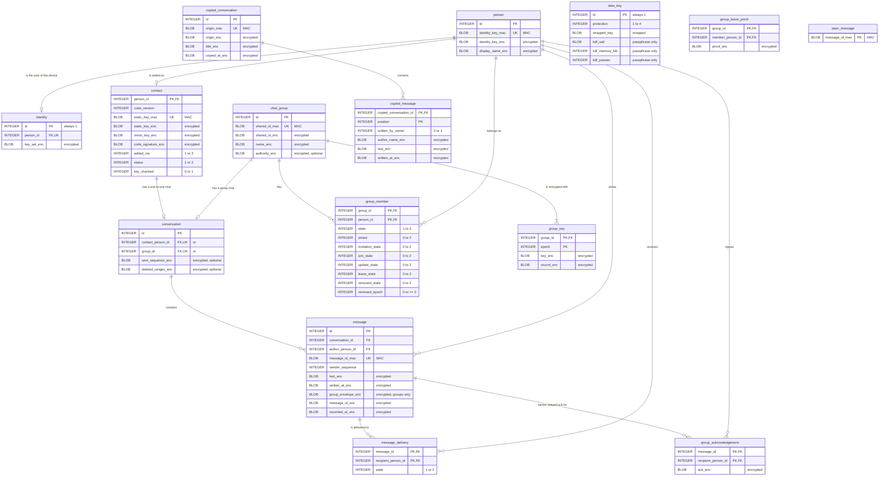

# P2PMessenger.Storage: the local database

Each device keeps its data in one SQLite database of its own. There is no server: contacts, keys and messages exist only on the devices of the people who use the app. The only data that leaves a device on purpose is a copy of chosen chats on the user's own PC, which that PC keeps in the `copied_conversation` and `copied_message` tables.

This file documents the database: the design rules, the logical schema, how stored data is protected, the data dictionary, normalisation, migrations, and how to create and inspect a database. The schema is created and changed only by the numbered scripts in [`Migrations`](Migrations); nothing is created by hand.

**Status:** the schema, its migrations, the encryption described in [How stored data is protected](#how-stored-data-is-protected) and the repositories exist, with their tests. The app keeps its identity, contacts, messages, its groups with their signed member lists, epoch keys, current admin authority, member leaving/removal states and signed leave proofs, the delivery state of its own messages for each recipient, relayed signed group acknowledgements for other members' messages, the IDs of seen messages and read-only chats copied from a phone to a PC here, on Windows, Linux and Android, and deletes a chat (one-to-one or group), a waiting message, a copied chat or all its data here, keeping what a deleted group chat had so that it does not come back. On Android the data key is wrapped by the Android Keystore.

## Contents

1. [Design rules](#design-rules)
2. [Logical schema](#logical-schema)
3. [How stored data is protected](#how-stored-data-is-protected)
4. [Data dictionary](#data-dictionary)
5. [Normalisation](#normalisation)
6. [Migrations](#migrations)
7. [Creating and inspecting a database](#creating-and-inspecting-a-database)

## Design rules

- **Engine:** SQLite through Microsoft.Data.Sqlite, which brings its own SQLite build (SQLitePCLRaw `e_sqlite3`), so Windows, Linux and Android run the same SQLite version.
- **Types are enforced:** every table is `STRICT`, so SQLite refuses a value of the wrong type, for example text in a `BLOB` column.
- **Keys:** an entity table has a surrogate key, `id INTEGER PRIMARY KEY` (SQLite's row ID). Tables that only connect or depend on other rows (`group_member`, `group_key`, `message_delivery`, `group_acknowledgement`, `copied_message`, `seen_message`) use their natural key, composite where needed, and are `WITHOUT ROWID`. The two single-row tables (`data_key`, `identity`) allow only `id = 1`.
- **Foreign keys are enforced:** every connection is opened with `PRAGMA foreign_keys = ON`. `ON DELETE CASCADE` is used where a child row means nothing without its parent (the messages of a chat, the members and keys of a group); everywhere else the default, `NO ACTION`, refuses a delete that would leave rows without their parent.
- **Coded values** are small integers limited by `CHECK` constraints. The codes are listed with each column in the [data dictionary](#data-dictionary).
- **Encrypted values and MACs** are `BLOB` columns whose length is checked: an encrypted value has at least 40 bytes, a MAC exactly 32.
- **Connection settings:** besides foreign keys, every connection uses the `WAL` journal, so reading does not wait for writing, and `PRAGMA secure_delete = ON`, so SQLite overwrites deleted content with zeros and a deleted chat does not stay readable in free pages of the file. `SqliteDatabase.OpenAsync` sets all three.
- **Names:** `snake_case`, singular table names. A column ending in `_enc` is encrypted and one ending in `_mac` holds a MAC. `group` is an SQL keyword, so the group table is `chat_group`.

## Logical schema



The model in words:

- A **person** is anyone the app knows by an identity key: the user of this device (through `identity`), the user's contacts (through `contact`), and members of the user's groups whom the user has not added as contacts yet. Messages, group memberships and deliveries refer to persons, so the user and everyone else are handled the same way, and a group message keeps its author when the author is not, or no longer, a contact.
- A **contact** is a person whose contact code the user has added. A **chat** (`conversation`) belongs either to one contact or to one group, never both.
- A **group** (`chat_group`) has members (`group_member`), one key and signed record per epoch (`group_key`), a current admin authority (`authority_enc`), and signed leave proofs (`group_leave_proof`) held while still needed to prove leaving or admin handover across members. Removing or losing a member rotates a new epoch with a new key while keeping earlier epoch records so stored history and handover chains validate cleanly.
- A **message** belongs to a chat and has an author. For the user's own messages, `message_delivery` holds one state per recipient. The **outbox** is a view: the deliveries still waiting. For an incoming group message written by another member, `group_acknowledgement` holds signed confirmations from other recipients while this device passes them back toward the author or through other members, deleted once the author confirms receipt.
- `seen_message` remembers the IDs of received messages, and `data_key` holds the key that encrypts everything else. Both stand alone.
- `copied_conversation` and `copied_message` exist on the user's PC only: a read-only copy of chats from the user's phone, kept apart from the PC's own chats and not linked to its contacts.

## How stored data is protected

A copy of the database file must not reveal keys, contacts or messages on another device. Every column falls into one of four classes:

| Class | Columns | What is stored | Why |
| --- | --- | --- | --- |
| Plain | Keys, foreign keys, coded values, counters | The value itself | Carries the structure of the data; holds no names, keys, texts, addresses or times |
| Encrypted | Name ends in `_enc` | XChaCha20-Poly1305 under the data key: a 24-byte random nonce, the ciphertext and a 16-byte tag, so at least 40 bytes. The associated data names the table, the column and the row, so a value moved to another row or column does not decrypt | Names, keys, texts and times are unreadable without the data key |
| MAC | Name ends in `_mac` | Keyed BLAKE2b-256 of the value (32 bytes), under a key derived from the data key | Equal values give equal MACs, so the database can find a value and enforce `UNIQUE` without storing the value; without the key, a MAC reveals nothing about it |
| Wrapped | `data_key.wrapped_key` | The data key, encrypted by a key derived from the user's passphrase or by the platform's key store | Without the passphrase, or on another device, the data key cannot be recovered |

The data key is 32 random bytes made on the device. It is never stored unwrapped, and every `_enc` and `_mac` value depends on it. Plain columns still show how many contacts, chats and messages there are, which rows refer to which and which of the user's messages are still waiting; they show no content. Encryption keeps content secret but does not stop changes to plain columns: someone who can write the file could, for example, mark a waiting message as received.

### Keys, values and MACs in detail

All cryptography comes from libsodium through NSec (`Protection/RecordKeys.cs`).

- **Two keys from the data key.** HKDF-SHA-256 extracts a pseudorandom key from the data key with the salt `P2PM/storage/v1` and expands two keys from it: with the info `P2PM/storage/v1/record-key` the XChaCha20-Poly1305 key for `_enc` values, and with `P2PM/storage/v1/lookup-key` the BLAKE2b-256 key for `_mac` values. The data key itself is cleared from memory once the two keys exist.
- **An encrypted value** is a random 24-byte nonce, then the ciphertext, then the 16-byte tag. The associated data is the ASCII text `P2PM/storage/v1`, a zero byte, the table name, a zero byte, the column name, a zero byte and the row's key as a big-endian 64-bit integer. For example, the name in row 2 of `person` is bound to the bytes of `P2PM/storage/v1`, `00`, `person`, `00`, `display_name_enc`, `00` and `00 00 00 00 00 00 00 02`. For `group_acknowledgement`, the 64-bit row key packs `(message_id << 32) | recipient_person_id`, so moving a relayed acknowledgement to another message or recipient fails authentication. For `group_leave_proof`, the 64-bit row key packs `(group_id << 32) | member_person_id`, so moving a leave proof to another group or member fails authentication too. For `copied_message`, the 64-bit row key packs `(copied_conversation_id << 32) | (written_by_owner << 31) | position`, so moving a message between copied chats, reordering it or flipping `written_by_owner` fails authentication too. A value copied to another row, column or table does not decrypt.
- **A MAC** is BLAKE2b-256 under the lookup key of `P2PM/lookup/v1/` and a domain name (`identity-key`, `static-key`, `message-id`, `group-id` or `copy-origin`), a zero byte and the value. The same message ID gives the same MAC in `message` and in `seen_message`.
- **What is inside an encrypted value:** public keys as their 32 bytes, the user's private keys as one 97-byte block (a version byte and the three 32-byte private keys), a copied conversation's origin ID as its 32 bytes, names and texts as UTF-8, a contact code's signature as its 64 bytes, a message ID as its 16 bytes, times as an 8-byte big-endian count of 100-nanosecond ticks since 0001-01-01 UTC, and a sequence number as an 8-byte big-endian integer of at least 1.
- **Reading checks everything.** Every value must decrypt with its own associated data, every MAC (including `copied_conversation.origin_mac` against `origin_enc`) must match the value it was made from, every copied message list must have contiguous positions from 1, every relayed group acknowledgement must match its message, group, epoch and recipient and carry a valid Ed25519 signature, and a contact code rebuilt from its parts must carry a valid signature. If anything fails, the app reads nothing and says that the stored data was changed or damaged.

### How the data key is wrapped

| `data_key.protection` | On | `data_key.wrapped_key` |
| --- | --- | --- |
| 2, Windows DPAPI | Windows | The data key protected by DPAPI for the current Windows user |
| 4, Linux Secret Service | Linux | A format byte (1), a random 16-byte key ID, a 24-byte nonce, the data key encrypted with XChaCha20-Poly1305 under a 32-byte wrapping key, and the tag (89 bytes). The wrapping key is a secret in the user's Secret Service (for example GNOME Keyring or KWallet), labelled "P2PMessenger data key" and found by the key ID |
| 1, passphrase | Every platform | Argon2id turns the passphrase (the UTF-8 bytes of its NFKC form) into 32 bytes, with a random 16-byte salt, 64 MiB of memory, 3 passes and one lane, stored in `kdf_salt`, `kdf_memory_kib` and `kdf_passes`. The first byte gives the format. **Format 1**, where no key store answers (a Linux desktop without a Secret Service, and data that an earlier Android build saved before it used the Android Keystore): the format byte, a random 24-byte nonce, the data key encrypted with XChaCha20-Poly1305 under the Argon2id result, and the tag (73 bytes). **Format 2**, wherever a key store answers: the format byte, the key store's code (2, 3 or 4, as in this table), the length of the protected share (big-endian, 2 bytes), the protected share, then the nonce, the encrypted data key and the tag. The share is 32 random bytes that the key store protects as it protects a data key; the wrapping key comes from HKDF-SHA-256 (salt `P2PM/data-key/passphrase/v2`, info `P2PM/data-key/passphrase/v2/wrap-key`) over the Argon2id result followed by the share, so both the passphrase and the key store are needed. The associated data is `P2PM/data-key/passphrase/v1` or `.../v2`, the format byte (and the key store's code), the salt, and the memory and passes as big-endian 32-bit numbers, so the stored parameters cannot be changed unnoticed. A row with memory outside 8 KiB to 1 GiB, passes outside 1 to 16, another salt length or a malformed wrapped key is read as damaged (`Protection/PassphraseKeyWrap.cs`) |
| 3, Android Keystore | Android | 77 bytes: a format byte (1), a random 16-byte key ID, a 12-byte nonce, the data key encrypted with AES-256-GCM, and the tag. The key is a non-exportable AES-256 key in the Android Keystore under the alias `p2pm-data-key-` and the key ID in hexadecimal, kept in StrongBox where the phone has one and in the TEE otherwise, and usable while the phone is locked. The associated data is `P2PM/data-key/android-keystore/v1`, the format byte and the key ID |

A copy of the database on another computer, or under another user account on the same computer, cannot be read, because that account's key store does not hold the key (or the share); this holds with a passphrase too. Where no key store answers (a Linux desktop with no Secret Service), the data is saved only under a passphrase, and a copy cannot be read without it. A new key row replaces the old one in one statement, and the database then empties its journal (`PRAGMA wal_checkpoint(TRUNCATE)`), so with `secure_delete` the old wrapped key stays in neither file. Changing the passphrase re-wraps the same data key; it does not encrypt the records again.

## Data dictionary

Column **Key**: PK primary key, FK foreign key, UK unique. **Class**: see [How stored data is protected](#how-stored-data-is-protected). Every table is `STRICT`.

### `data_key`

The data key that encrypts every `_enc` column, wrapped by a passphrase or by the platform's key store. One row.

| Column | Type | Null | Key | Class | Description |
| --- | --- | --- | --- | --- | --- |
| `id` | INTEGER | No | PK | Plain | Always 1 (`CHECK (id = 1)`) |
| `protection` | INTEGER | No | | Plain | What wraps the data key: 1 = a key derived from the user's passphrase with Argon2id, 2 = Windows DPAPI (current user), 3 = Android Keystore, 4 = Linux Secret Service |
| `wrapped_key` | BLOB | No | | Wrapped | The wrapped data key; not empty. Its format depends on `protection` ([How the data key is wrapped](#how-the-data-key-is-wrapped)) |
| `kdf_salt` | BLOB | Yes | | Plain | Argon2id salt, 16 bytes |
| `kdf_memory_kib` | INTEGER | Yes | | Plain | Argon2id memory cost in KiB, above 0 |
| `kdf_passes` | INTEGER | Yes | | Plain | Argon2id number of passes, above 0 |

Constraint: the three `kdf_` columns are all set when `protection = 1` and all NULL otherwise.

### `person`

Everyone the app knows by an identity key: the user of this device, the user's contacts, and group members not added as contacts yet.

| Column | Type | Null | Key | Class | Description |
| --- | --- | --- | --- | --- | --- |
| `id` | INTEGER | No | PK | Plain | Surrogate key |
| `identity_key_mac` | BLOB | No | UK | MAC | MAC of the person's Ed25519 identity public key; finds a person by key and keeps one row per person |
| `identity_key_enc` | BLOB | No | | Encrypted | The Ed25519 identity public key (32 bytes), which checks the person's signatures |
| `display_name_enc` | BLOB | No | | Encrypted | The display name: for a contact, the name signed in their contact code; for another group member, the name the group gave |

### `identity`

The user of this device: their person row and their private keys. One row.

| Column | Type | Null | Key | Class | Description |
| --- | --- | --- | --- | --- | --- |
| `id` | INTEGER | No | PK | Plain | Always 1 (`CHECK (id = 1)`) |
| `person_id` | INTEGER | No | FK `person.id`, UK | Plain | The user's own person row, with their identity key and name |
| `key_set_enc` | BLOB | No | | Encrypted | The user's private keys: the identity, static and onion-service keys (97 bytes before encryption). They never leave the device |

### `contact`

A person the user has added by exchanging contact codes. With `person.identity_key_enc` and `person.display_name_enc`, these columns rebuild the person's contact code byte for byte.

| Column | Type | Null | Key | Class | Description |
| --- | --- | --- | --- | --- | --- |
| `person_id` | INTEGER | No | PK, FK `person.id` | Plain | The person; deleting the person deletes the contact |
| `code_version` | INTEGER | No | | Plain | Format version of the contact code; 1 is the only version so far |
| `static_key_mac` | BLOB | No | UK | MAC | MAC of the X25519 static key; no two contacts share a static key |
| `static_key_enc` | BLOB | No | | Encrypted | The X25519 static public key, used to set up encrypted sessions with the contact |
| `onion_key_enc` | BLOB | No | | Encrypted | The public key of the contact's Tor onion service; the onion address is computed from it |
| `code_signature_enc` | BLOB | No | | Encrypted | The identity key's signature over the contact code |
| `added_via` | INTEGER | No | | Plain | How the codes were exchanged: 1 = in person, scanning each other's QR codes; 2 = through another channel (a text, file or QR image sent in another messenger) |
| `status` | INTEGER | No | | Plain | 1 = waiting for the first connection, in which the contact's app proves that it holds the private keys; 2 = confirmed |
| `key_checked` | INTEGER | No | | Plain | 1 when the user compared fingerprints and marked the key as checked, otherwise 0 (default 0) |

### `chat_group`

A small group of contacts.

| Column | Type | Null | Key | Class | Description |
| --- | --- | --- | --- | --- | --- |
| `id` | INTEGER | No | PK | Plain | Surrogate key |
| `shared_id_mac` | BLOB | No | UK | MAC | MAC of the group's ID; finds the group of an incoming group message |
| `shared_id_enc` | BLOB | No | | Encrypted | The group's random ID, the same on every member's device and carried in group messages |
| `name_enc` | BLOB | No | | Encrypted | The group's name |
| `authority_enc` | BLOB | Yes | | Encrypted | The 32-byte identity key of the current admin authority (NULL falls back to epoch 1's signer for legacy rows; verified to appear in the group's epoch history). Added by `0009_group_membership.sql` |

### `group_member`

Who is, or was, in a group, the user included. `WITHOUT ROWID`.

| Column | Type | Null | Key | Class | Description |
| --- | --- | --- | --- | --- | --- |
| `group_id` | INTEGER | No | PK, FK `chat_group.id` | Plain | The group; deleting the group deletes its members |
| `person_id` | INTEGER | No | PK, FK `person.id` | Plain | The member |
| `state` | INTEGER | No | | Plain | 1 = active member, 2 = removed, 3 = left the group |
| `joined` | INTEGER | No | | Plain | 0 = not joined yet, 1 = joined with the same member list as this device's, 2 = joined with another member list. The person who signed the group's record counts as joined. Added by `0005_groups.sql` |
| `invitation_state` | INTEGER | No | | Plain | The invitation that this device sends that member as the group's creator: 0 = none, 1 = waiting, 2 = received by the member's app. Added by `0005_groups.sql` |
| `join_state` | INTEGER | No | | Plain | The user's own join, sent to that member: 0 = none, 1 = waiting, 2 = received by the member's app. Added by `0005_groups.sql` |
| `update_state` | INTEGER | No | | Plain | The current-epoch `GroupUpdate` notice state for that member: 0 = none, 1 = waiting, 2 = received. Added by `0009_group_membership.sql` |
| `leave_state` | INTEGER | No | | Plain | The user's `GroupLeave` notice state for that member after the user leaves: 0 = none, 1 = waiting, 2 = received. Added by `0009_group_membership.sql` |
| `removed_state` | INTEGER | No | | Plain | The current admin's `GroupRemoved` notice state for a removed member: 0 = none, 1 = waiting, 2 = received. Added by `0009_group_membership.sql` |
| `removed_epoch` | INTEGER | No | | Plain | Epoch at which a removed member was removed (0 when active/left or unknown; at least 2 when known or carrying `removed_state > 0`). Added by `0009_group_membership.sql` |

Index `ix_group_member_person (person_id)`: the groups of a person. Whether a member still has to be added as a contact is not stored: it is a member whose person has no `contact` row.

### `group_leave_proof`

Signed `GroupLeave` proofs kept for pending leave notices and admin handover chains so offline members can verify authority changes across epochs. `WITHOUT ROWID`.

| Column | Type | Null | Key | Class | Description |
| --- | --- | --- | --- | --- | --- |
| `group_id` | INTEGER | No | PK, FK `chat_group.id` | Plain | The group |
| `member_person_id` | INTEGER | No | PK, FK `person.id` | Plain | The member who signed the leave proof |
| `proof_enc` | BLOB | No | | Encrypted | The 117-byte or 149-byte signed `GroupLeave` notice, bound to `(group_id << 32) \| member_person_id` and verified on load |

### `group_key`

The keys that encrypt a group's messages, one per epoch. A removal starts a new epoch with a new key, so a removed member cannot read later messages. `WITHOUT ROWID`.

| Column | Type | Null | Key | Class | Description |
| --- | --- | --- | --- | --- | --- |
| `group_id` | INTEGER | No | PK, FK `chat_group.id` | Plain | The group; deleting the group deletes its keys |
| `epoch` | INTEGER | No | PK | Plain | The key's number within the group, from 1 |
| `key_enc` | BLOB | No | | Encrypted | The group key. Its associated data names the row as the group's row times 2^32 plus the epoch |
| `record_enc` | BLOB | No | | Encrypted | The group's record for that epoch as its signer signed it: the group ID, the epoch, the name, the members and the signature. Loading checks the signature, that the record names this group, its name and this key, and that the members match the `group_member` rows. Added by `0005_groups.sql` |

### `conversation`

A chat: with one contact, or in one group.

| Column | Type | Null | Key | Class | Description |
| --- | --- | --- | --- | --- | --- |
| `id` | INTEGER | No | PK | Plain | Surrogate key |
| `contact_person_id` | INTEGER | Yes | FK `contact.person_id`, UK | Plain | The contact of a one-to-one chat; deleting the contact deletes the chat |
| `group_id` | INTEGER | Yes | FK `chat_group.id`, UK | Plain | The group of a group chat; deleting the group deletes the chat |
| `sent_sequence_enc` | BLOB | Yes | | Encrypted | One-to-one chats only: the highest sequence number of the user's own messages that were deleted from this chat; empty until the user deletes a message of the chat. Added by `0004_sent_sequence.sql` |
| `deleted_ranges_enc` | BLOB | Yes | | Encrypted | Group chats only: for each author, the ranges of sequence numbers of the messages that were deleted from this chat, the user's own included; empty until the user deletes a message of the chat. Added by `0006_deleted_group_messages.sql` |

Constraint: exactly one of `contact_person_id` and `group_id` is set. Both are unique, so a contact or a group has at most one chat. `sent_sequence_enc` and `deleted_ranges_enc` are empty or at least 40 bytes.

Deleting a chat in the app deletes its messages, and with them their deliveries, but keeps the `conversation` row. Before the messages go, the highest sequence number among the user's own messages in the chat is stored in `sent_sequence_enc`, unless a higher one is there already; deleting a single waiting message stores it the same way. The next message to the contact then continues after the deleted ones, so the contact's app, which still has them and orders each sender's messages by number, shows it after them, and no number is used twice. When the app starts, a chat's next number is one more than the higher of `sent_sequence_enc` and its stored own messages.

A group chat keeps more than that, because its messages come from several authors and the members' apps pass on to each other the messages that one of them lacks: deleting a group chat, or the user's own group message that no member's app has yet, stores in `deleted_ranges_enc`, for each author, which sequence numbers this device had. The value is a 4-byte count followed by that many entries of the author's 32-byte identity key and the first and last sequence number of a range (8 bytes each, big-endian), sorted by key and first number, with ranges of one author neither overlapping nor touching; it is sealed like every encrypted value, bound to its `conversation` row, and replaced as a whole. The app refuses a group message whose author and number fall in a deleted range, a resent copy of a deleted message is confirmed but not shown again (its ID stays in `seen_message`), and the user's next group message is numbered after the highest of the user's own deleted ones. Loading checks the count, the length and the order, and a value that fails any check is "damaged".

### `message`

A message in a chat, written by the user or received.

| Column | Type | Null | Key | Class | Description |
| --- | --- | --- | --- | --- | --- |
| `id` | INTEGER | No | PK | Plain | Surrogate key; also the order in which messages reached this device |
| `conversation_id` | INTEGER | No | FK `conversation.id` | Plain | The chat; deleting the chat deletes its messages |
| `author_person_id` | INTEGER | No | FK `person.id` | Plain | Who wrote it; the user's own person for the user's messages |
| `message_id_mac` | BLOB | No | UK | MAC | MAC of the message's random 16-byte ID; matches acknowledgements to the message and keeps one row per message |
| `sender_sequence` | INTEGER | No | | Plain | The author's running number in this chat, from 1; keeps each author's messages in the order written |
| `text_enc` | BLOB | No | | Encrypted | The text |
| `written_at_enc` | BLOB | No | | Encrypted | When the author wrote it, by the author's clock: shown, never trusted |
| `group_envelope_enc` | BLOB | Yes | | Encrypted | In a group: the message as its author signed it, kept so that it can be passed on to other members unchanged. NULL in one-to-one chats |
| `message_id_enc` | BLOB | No | | Encrypted | The message's random 16-byte ID, the same on every device; a waiting message is sent again under it, so that the recipient drops a copy it already has. Added by `0002_message_id.sql` |
| `recorded_at_enc` | BLOB | No | | Encrypted | When this device recorded the message (sent or received), by this device's clock; orders the user's messages and the other person's in a chat. Added by `0002_message_id.sql` |

Constraint: `UNIQUE (conversation_id, author_person_id, sender_sequence)`. The two columns of `0002_message_id.sql` have the default `x''`, which their `CHECK (length(...) >= 40)` refuses, so every insert must give a real value (SQLite needs a default to add a `NOT NULL` column to an existing table). Indexes: `ix_message_conversation (conversation_id, id)`, a chat's messages in order; `ix_message_author (author_person_id)`.

### `message_delivery`

The delivery state of the user's own message for each recipient: one row in a one-to-one chat, one per member in a group. `WITHOUT ROWID`.

| Column | Type | Null | Key | Class | Description |
| --- | --- | --- | --- | --- | --- |
| `message_id` | INTEGER | No | PK, FK `message.id` | Plain | The message; deleting it deletes its delivery rows |
| `recipient_person_id` | INTEGER | No | PK, FK `person.id` | Plain | The recipient |
| `state` | INTEGER | No | | Plain | 1 = waiting: on this device, to be sent or sent again; 2 = received by the contact's app, which returned an authenticated acknowledgement. There is no "read" state |

Index `ix_message_delivery_waiting (recipient_person_id) WHERE state = 1`: the waiting messages for a contact who has just become reachable.

In a one-to-one chat, every message the user writes gets exactly one row, for the contact, in the same transaction that stores the message, in state 1. The state becomes 2 only when that contact's app acknowledges the message's ID in an encrypted session with this device, and it never goes back. A received message has no row. When the app reads its data, a message of the user without exactly this row, or a received message with a row, counts as damaged, like a value that does not decrypt.

### `group_acknowledgement`

Signed group acknowledgements held temporarily for incoming group messages so this device can pass them to the message's author or through other members. Accepted only for a locally stored incoming group message of the same group and epoch where the signer is a member distinct from the author and the user; deleted by `ON DELETE CASCADE` when the group chat's messages are deleted, and deleted permanently once the author confirms receipt. `WITHOUT ROWID`.

| Column | Type | Null | Key | Class | Description |
| --- | --- | --- | --- | --- | --- |
| `message_id` | INTEGER | No | PK, FK `message.id` | Plain | The group message; deleting the message deletes its relayed acknowledgements (`ON DELETE CASCADE`) |
| `recipient_person_id` | INTEGER | No | PK, FK `person.id` | Plain | The group member who signed the acknowledgement |
| `ack_enc` | BLOB | No | | Encrypted | The 132-byte signed group acknowledgement (group ID, epoch, message ID, recipient identity key and Ed25519 signature), bound to `(message_id << 32) \| recipient_person_id` |

### `seen_message`

The IDs of messages already received or sent, so that a repeated, replayed or reflected message is dropped. An ID is added in the same transaction that stores its message, so a message is never stored without its ID being seen. Kept when a chat is deleted. `WITHOUT ROWID`.

| Column | Type | Null | Key | Class | Description |
| --- | --- | --- | --- | --- | --- |
| `message_id_mac` | BLOB | No | PK | MAC | MAC of a received or sent message's ID |

### `copied_conversation`

On the user's PC: a chat copied from the user's phone. Read-only; copying the same chat again atomically replaces it in one transaction while leaving other copied chats untouched.

| Column | Type | Null | Key | Class | Description |
| --- | --- | --- | --- | --- | --- |
| `id` | INTEGER | No | PK | Plain | Surrogate key |
| `origin_mac` | BLOB | No | UK | MAC | MAC of the 32-byte copy origin ID (`copy-origin` domain); a new copy of the same chat replaces the old one |
| `origin_enc` | BLOB | No | | Encrypted | The 32-byte copy origin ID, so loading checks `origin_mac` against the decrypted value. Added by `0007_copied_conversation_origin.sql` |
| `title_enc` | BLOB | No | | Encrypted | The chat's title: the contact's or the group's name |
| `copied_at_enc` | BLOB | No | | Encrypted | When it was copied |

### `copied_message`

A message of a copied chat. `WITHOUT ROWID`. Each encrypted column's associated data binds `(copied_conversation_id << 32) | (written_by_owner << 31) | position`, so changing `written_by_owner`, moving a value to another position or another copied conversation fails decryption.

| Column | Type | Null | Key | Class | Description |
| --- | --- | --- | --- | --- | --- |
| `copied_conversation_id` | INTEGER | No | PK, FK `copied_conversation.id` | Plain | The copied chat; deleting it deletes its messages |
| `position` | INTEGER | No | PK | Plain | Place in the chat, contiguous from 1 |
| `written_by_owner` | INTEGER | No | | Plain | 1 if the user wrote it on the phone, otherwise 0; also bound into each encrypted column's associated data |
| `author_name_enc` | BLOB | Yes | | Encrypted | The author's name; NULL exactly when `written_by_owner` is 1 |
| `text_enc` | BLOB | No | | Encrypted | The text |
| `written_at_enc` | BLOB | No | | Encrypted | When the author wrote it |

### View `outbox`

The messages waiting to be sent: `message_id`, `recipient_person_id` and `conversation_id` of every delivery in state 1. Because it is a view over `message_delivery` and not a table of its own, a message cannot be both waiting and received, and deleting a chat removes its waiting messages through the cascade.

### Indexes

| Index | Table and columns | Used for |
| --- | --- | --- |
| `ix_group_member_person` | `group_member (person_id)` | The groups of a person |
| `ix_message_conversation` | `message (conversation_id, id)` | A chat's messages in order |
| `ix_message_author` | `message (author_person_id)` | A person's messages, and the foreign key check when a person is deleted |
| `ix_message_delivery_waiting` | `message_delivery (recipient_person_id) WHERE state = 1` | The waiting messages for one recipient |

Every primary key and `UNIQUE` constraint has its own index as well.

## Normalisation

The schema is in third normal form:

- **1NF:** every column holds one value. A contact code is not stored as one blob: its parts are columns of `person` and `contact`, and the code is rebuilt from them.
- **2NF:** in the tables with composite keys (`group_member`, `group_key`, `group_leave_proof`, `message_delivery`, `group_acknowledgement`, `copied_message`), every other column depends on the whole key.
- **3NF:** no column depends on another non-key column. Facts that follow from other rows are queried, not stored: whether a group member still has to be added (no `contact` row), whether the user is in a group (the user's `group_member` row), whether a chat is one-to-one or a group chat (which foreign key is set), and which messages wait (the `outbox` view).

Two kinds of derived values are kept on purpose:

- **MAC columns** are derived from the encrypted value next to them. Like an index, they are the only way to search encrypted data and to enforce `UNIQUE` on it.
- **`person.identity_key_enc` of the user** could be derived from `identity.key_set_enc`. It is stored so that the user is a person like everyone else, with no special case in queries.

## Migrations

- The schema lives in numbered SQL scripts, `Migrations/NNNN_name.sql`. They are embedded in the assembly (`MigrationCatalog`):

  | Script | What it does |
  | --- | --- |
  | `0001_initial.sql` | Creates the 13 tables, the 4 indexes and the `outbox` view |
  | `0002_message_id.sql` | Adds `message.message_id_enc` and `message.recorded_at_enc`. It is refused, and rolled back, in a database that already holds messages, because those would have no value for the new columns; no released version of the app stored messages before it |
  | `0003_outgoing_delivery.sql` | Changes no table. Gives every one-to-one message the user sent before deliveries were kept a `message_delivery` row in state 1 (waiting): the app had not been told that those messages arrived, so it sends them again under the same IDs, and the contact's app, which drops a copy it already has, confirms them |
  | `0004_sent_sequence.sql` | Adds `conversation.sent_sequence_enc`, empty in every existing row, so that a chat keeps its next sequence number when its messages are deleted (see [`conversation`](#conversation)) |
  | `0005_groups.sql` | Adds `group_key.record_enc` and `group_member.joined`, `invitation_state` and `join_state`. No earlier version stored a group, so no row needs a value |
  | `0006_deleted_group_messages.sql` | Adds `conversation.deleted_ranges_enc`, empty for every existing chat |
  | `0007_copied_conversation_origin.sql` | Adds `copied_conversation.origin_enc`, storing the encrypted 32-byte copy origin ID so `origin_mac` is verified on every load. No earlier version wrote rows to `copied_conversation` |
  | `0008_group_acknowledgements.sql` | Creates the `group_acknowledgement` table (`STRICT, WITHOUT ROWID`) to persist verified relayed signed group acknowledgements keyed by `(message_id, recipient_person_id)` with `ON DELETE CASCADE` on `message (id)` |
  | `0009_group_membership.sql` | Adds `chat_group.authority_enc`, adds `update_state`, `leave_state`, `removed_state` and `removed_epoch` to `group_member`, and creates the `group_leave_proof` table (`STRICT, WITHOUT ROWID`) |

- `MigrationRunner.MigrateAsync` reads the schema version from `PRAGMA user_version`, applies every newer script in order, and records the new version. Each script runs in one transaction together with the version update, so a failing script leaves the database at the previous version.
- A database whose version is newer than the newest script is refused, not changed.
- A script that has been released is never edited. A change to the schema is a new script with the next number.

## Creating and inspecting a database

A database can be built from the scripts in two ways: with the SQLite command-line shell, which needs nothing else and leaves a file to look at, or with the tests, which use the app's own migration code. Run every command below from the root of the repository.

### What you need

- **The SQLite command-line shell, version 3.37 or later**, the first version with `STRICT` tables. Check it with `sqlite3 --version`. On Windows it is in the `sqlite-tools` zip on the [SQLite download page](https://sqlite.org/download.html); on Linux it is the `sqlite3` package.
- **Optionally, a viewer** such as DB Browser for SQLite, version 3.13 or later. Version 3.12 and older bundle an SQLite older than 3.37 and cannot open a database with `STRICT` tables.
- **For the tests only:** the .NET 10 SDK named in [`global.json`](../../global.json), that release or a later patch of the same feature band. The Android workload is not needed.

### Create a database

```
sqlite3 review.db ".read src/P2PMessenger.Storage/Migrations/0001_initial.sql" ".read src/P2PMessenger.Storage/Migrations/0002_message_id.sql" ".read src/P2PMessenger.Storage/Migrations/0003_outgoing_delivery.sql" ".read src/P2PMessenger.Storage/Migrations/0004_sent_sequence.sql" ".read src/P2PMessenger.Storage/Migrations/0005_groups.sql" ".read src/P2PMessenger.Storage/Migrations/0006_deleted_group_messages.sql" ".read src/P2PMessenger.Storage/Migrations/0007_copied_conversation_origin.sql" ".read src/P2PMessenger.Storage/Migrations/0008_group_acknowledgements.sql" ".read src/P2PMessenger.Storage/Migrations/0009_group_membership.sql"
```

Read the scripts in number order. The shell leaves `user_version` at 0, because the migration runner, not the script, records the version.

To look at the result:

```
sqlite3 review.db ".tables" ".schema message" "PRAGMA foreign_key_list(message);"
```

or open `review.db` in the viewer. The tables are empty; the next part fills them with test rows.

### Try the constraints by hand

Open the database in the shell:

```
sqlite3 review.db
```

The shell does not enforce foreign keys unless asked, so the first line below turns them on, as the app does on every connection. Without it, a row that points to nothing is accepted and deleting a chat leaves its messages behind. Stored values are encrypted, so the rows use random bytes of the right length instead: 32 for a MAC, and 40, the shortest encrypted value, for an `_enc` column. Paste:

```sql
PRAGMA foreign_keys = ON;
INSERT INTO person (id, identity_key_mac, identity_key_enc, display_name_enc) VALUES
    (1, randomblob(32), randomblob(40), randomblob(40)),
    (2, randomblob(32), randomblob(40), randomblob(40));
INSERT INTO identity (id, person_id, key_set_enc) VALUES (1, 1, randomblob(40));
INSERT INTO contact (person_id, code_version, static_key_mac, static_key_enc, onion_key_enc, code_signature_enc, added_via, status)
    VALUES (2, 1, randomblob(32), randomblob(40), randomblob(40), randomblob(40), 1, 1);
INSERT INTO conversation (id, contact_person_id) VALUES (1, 2);
INSERT INTO message (id, conversation_id, author_person_id, message_id_mac, message_id_enc, sender_sequence, text_enc, written_at_enc, recorded_at_enc)
    VALUES (1, 1, 1, randomblob(32), randomblob(40), 1, randomblob(40), randomblob(40), randomblob(40));
INSERT INTO message_delivery (message_id, recipient_person_id, state) VALUES (1, 2, 1);
SELECT * FROM outbox;
```

This adds the user (person 1), a contact (person 2), a chat with the contact, and one message to the contact that is still waiting. `outbox` shows it as one row: message 1, recipient 2, conversation 1.

Each of the following statements is refused:

```sql
INSERT INTO message_delivery (message_id, recipient_person_id, state) VALUES (1, 99, 1);
INSERT INTO person (identity_key_mac, identity_key_enc, display_name_enc) VALUES (randomblob(31), randomblob(40), randomblob(40));
INSERT INTO person (identity_key_mac, identity_key_enc, display_name_enc) VALUES ('text', randomblob(40), randomblob(40));
UPDATE message_delivery SET state = 3;
INSERT INTO identity (id, person_id, key_set_enc) VALUES (2, 2, randomblob(40));
```

In order, they break the foreign key (there is no person 99), the length of a MAC (31 bytes instead of 32), the column type (text in a `BLOB` column of a `STRICT` table), the delivery state codes (only 1 and 2), and the single-row rule of `identity` (only `id = 1`).

Deleting the chat deletes its message and the message's delivery, so nothing is left waiting:

```sql
DELETE FROM conversation WHERE id = 1;
SELECT count(*) FROM message;
SELECT count(*) FROM message_delivery;
SELECT count(*) FROM outbox;
```

All three counts are 0. Do this part in the shell: a viewer has its own foreign key setting. The app itself deletes a chat's messages and keeps the `conversation` row, for the sequence number it holds (see [`conversation`](#conversation)); the cascade from `message` to `message_delivery` is the same.

### Run the tests

```
dotnet test --project tests/P2PMessenger.Storage.Tests
```

The tests build temporary databases with `MigrationRunner` and `SqliteDatabase`, the code the app uses, and delete them afterwards. They check that:

- the scripts are numbered from 1 without gaps, a new database gets every script and records the version, and a current database is left unchanged;
- a failing script is rolled back while the scripts before it stay applied, and a database newer than the app is refused and left as it is;
- every connection turns on foreign keys, the `WAL` journal and `secure_delete`;
- the tables are the documented ones and all `STRICT`, and a new database passes `PRAGMA integrity_check` and `PRAGMA foreign_key_check`;
- a message in a missing conversation, a MAC of the wrong length and a conversation with both a contact and a group are refused;
- deleting a chat deletes its messages and removes them from the outbox;
- the app's deletion of a chat removes only that chat's messages and deliveries, keeps the contact, the `conversation` row and the IDs of the deleted messages among the seen IDs, keeps the highest sequence number of the user's deleted messages, encrypted and bound to its chat, across a reopen, and leaves none of the deleted messages' stored text in the database files; only a message of the user that is still waiting can be deleted on its own; every flipped bit of a stored sequence number, and a sequence number moved to another chat, is refused;
- erasing the database for "delete all data" leaves no row in any table and no data key;
- a message without its ID or its recorded time is refused, and `0002_message_id.sql` is rolled back over a database that already holds a message;
- `0003_outgoing_delivery.sql` gives the user's earlier messages, and only those, a waiting delivery, and `0004_sent_sequence.sql` adds the sequence column;
- a message is stored together with its ID among the seen IDs and, if the user wrote it, its waiting delivery; the delivery becomes received only for the contact the message was sent to, and only once;
- a message of the user without its delivery, a delivery for another person, and a received message with a delivery are refused as damaged;
- a group comes back with the same signed record, key and member states, a member who is not a contact is stored as a person with the name from the record, a group key that does not fit the record or that was moved to another group's row is refused, and a group message keeps its signed envelope and one delivery per member, of which only the one for the member who confirmed it becomes received; a second message with an author's used sequence number is not stored;
- relayed signed group acknowledgements save only for locally stored incoming group messages of a matching epoch from another group member, round-trip across reopen, cascade-delete on group chat deletion leaving no plaintext or sealed bytes in the database files, refuse every flipped bit, moved row or re-sealed forged signature on load, and are erased by `EraseEverything` (`GroupAcknowledgementRepositoryTests`, `0008_group_acknowledgements.sql`);
- group membership state, epoch advancement, authority handover and leave proofs round-trip across reopen, clear settled leave proofs on epoch advance, refuse forged or mismatched leave proofs, non-member authorities and invalid removed/left notice states on load, and are erased by `EraseEverything` (`GroupMembershipRepositoryTests`, `0009_group_membership.sql`);
- copied conversations and copied messages save, replace atomically by origin ID, delete cleanly with `secure_delete` and journal truncation leaving no plaintext in the database files, refuse any flipped bit of any encrypted column or `origin_mac`, refuse a value moved to another row, column or position, refuse a flipped `written_by_owner` flag, and refuse gaps in message positions (`CopiedConversationRepositoryTests`, `CopiedFilesTests`, `0007_copied_conversation_origin.sql`);
- the key derivation and XChaCha20-Poly1305 give the published test vectors (RFC 5869, draft-irtf-cfrg-xchacha), and the associated data, two encrypted values and the MACs match an independent Python implementation;
- every flipped bit of every stored encrypted value and MAC, and a value moved to another row or column, is refused;
- a stored identity, contacts, messages and seen IDs come back unchanged after the database is closed and opened again;
- the database files hold no name, text, public or private key, message ID or data key in plain, and a copy opened with another data key gives nothing.

### Clean up

Delete `review.db` when you are done; it is not part of the repository.
