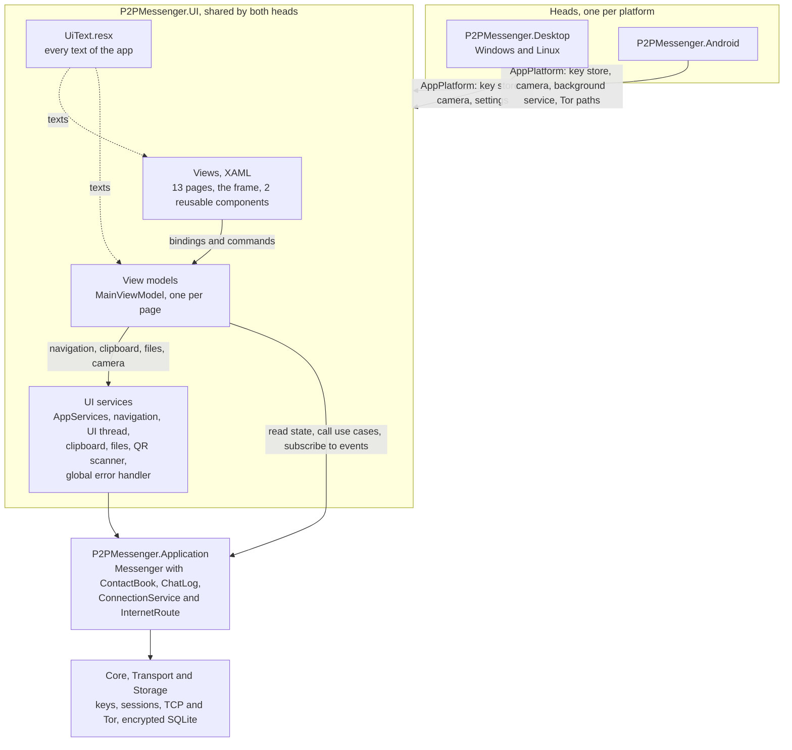
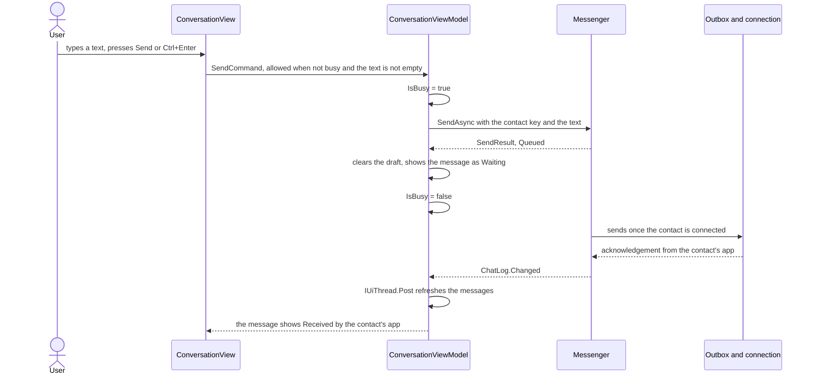
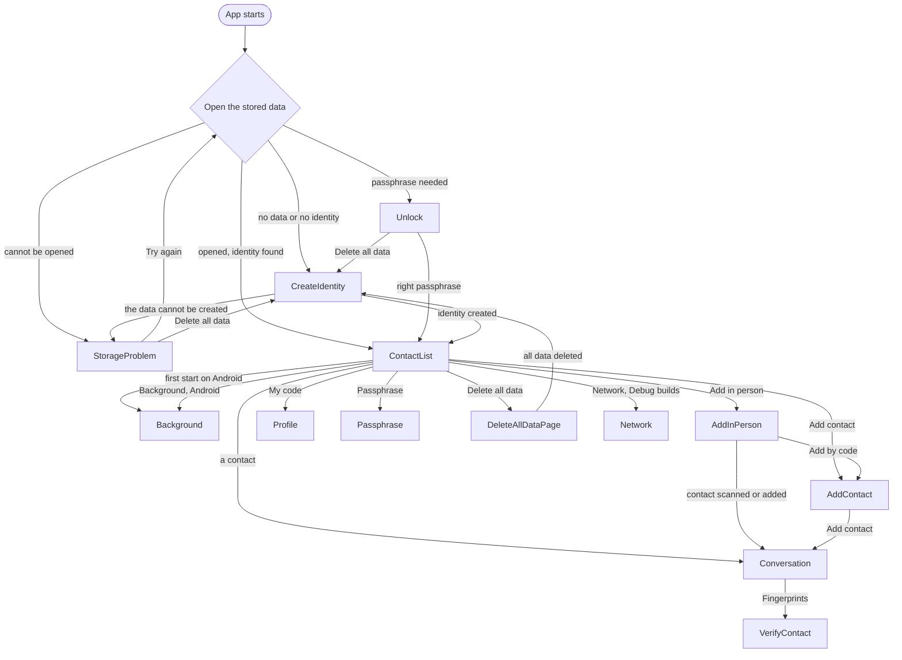

# P2PMessenger.UI: the front-end

The client of P2PMessenger is an Avalonia application written in C# with the MVVM pattern. `P2PMessenger.UI` holds everything the user sees: the views, the view models, the services that reach the platform, and every text of the app. The two heads, `P2PMessenger.Desktop` (Windows and Linux) and `P2PMessenger.Android`, start this project and provide the platform services: the key store, the camera and the background service. The front-end works with the application layer of its own process, described in [The API the front-end works with](#the-api-the-front-end-works-with).

This file is the front-end documentation: how to build, run and test the client, where each requirement of the front-end criterion is implemented, the technology stack and why it was chosen, the architecture and the navigation diagrams, state management, forms, error handling, loading states, logging, and the tests. Planned work is listed in [Planned](#planned).

**Status:** the client has 13 pages, a frame with navigation, a notice banner and a lock screen, and it runs on Windows, Linux and Android from one code base. The pages cover creating an identity, adding contacts (in person with a QR code, or by a pasted or saved code), comparing fingerprints, the contact list with each contact's reachability, one-to-one conversations with delivery states, the passphrase and the lock, deleting chats and all data, the Android background service and the state of Tor. The view models and views are tested headless with Avalonia.Headless, and two real apps are tested together over loopback. A global error handler, a progress bar for every asynchronous action, logging of unhandled errors and a search box on the contact list are built. Shared styles and a checked responsive layout are planned.

## Contents

1. [Build, run and test](#build-run-and-test)
2. [Where each requirement is implemented](#where-each-requirement-is-implemented)
3. [Technology stack and why](#technology-stack-and-why)
4. [Architecture](#architecture)
5. [Navigation and user flows](#navigation-and-user-flows)
6. [Forms and validation](#forms-and-validation)
7. [Error handling](#error-handling)
8. [Loading states](#loading-states)
9. [Logging](#logging)
10. [The API the front-end works with](#the-api-the-front-end-works-with)
11. [Tests](#tests)
12. [Planned](#planned)

## Build, run and test

Prerequisite: the .NET SDK pinned in `global.json` (10.0.404). MSBuild and the `dotnet` command restore, build, run and test the desktop client. The Android head also needs the android workload and the Android SDK; the [root README](../../README.md#prerequisites) lists them.

```
dotnet restore P2PMessenger.Desktop.slnf
dotnet build P2PMessenger.Desktop.slnf
dotnet run --project src/P2PMessenger.Desktop
dotnet test --project tests/P2PMessenger.UI.Tests
dotnet test --solution P2PMessenger.Desktop.slnf
dotnet format P2PMessenger.Desktop.slnf --verify-no-changes
dotnet build src/P2PMessenger.Android -c Debug
```

- To run two clients on one PC and see them talk, start the second with its own data folder: `dotnet run --project src/P2PMessenger.Desktop -- --data <folder>`. [Trying the app](../../README.md#trying-the-app) in the root README walks through creating two identities, adding the contacts and sending messages.
- The Android client is deployed to a connected phone with `dotnet build src/P2PMessenger.Android -t:Run`. To install an APK by hand, build it with `-p:EmbedAssembliesIntoApk=true`.
- Every push runs GitHub Actions (`.github/workflows/ci.yml`): a locked restore, the format check, a Release build with warnings as errors and all tests on Windows and Linux, and an Android build. The desktop build and the Debug APK of each run on `main` are kept as artifacts of the run.
- The app's own keys are made on the device when an identity is created and are protected by the platform's key store. The repository contains source, build and test files.

## Where each requirement is implemented

The criterion is written for web applications, so the right column also says what the web term means here.

| Requirement | Here | Status |
| --- | --- | --- |
| A client built with a modern framework (a SPA framework, Jetpack Compose, Avalonia) | Avalonia 12 with XAML views and MVVM. It is a single-window application whose pages are swapped in one frame, which is the desktop and mobile counterpart of a SPA. See [Technology stack and why](#technology-stack-and-why) | Done |
| Architecture diagram, architecture approach | [Architecture](#architecture): layers, project structure, MVVM, state | Done |
| User flows and navigation diagram | [Navigation and user flows](#navigation-and-user-flows) | Done |
| Tech stack justification | [Technology stack and why](#technology-stack-and-why) | Done |
| API documentation | [The API the front-end works with](#the-api-the-front-end-works-with): the in-process application API | Done |
| Components, containers or pages, services, modules | `Views/` (pages and the frame), `ViewModels/` (the logic of each page), `Controls/` and the reusable views, `Services/`, and the layers below. The projects of the solution are the modules | Done |
| Routing, at least 3 or 4 routes | 13 pages reached through the navigation stack of `MainViewModel`, [shown below](#navigation-and-user-flows) | Done |
| Local and global state | Local state in each view model, shell state in `MainViewModel`, application state in `Messenger`. See [State management](#state-management) | Done |
| Clear project structure: components, pages, services, models, styles | [Project structure](#project-structure). Shared styles are planned | Partly |
| Real API or mock, typed data, centralised request handling | The real application layer, typed by C# records, enums and result types; every call goes through `Messenger` and its services | Done |
| Bundler | MSBuild and the `dotnet` CLI | Done |
| Reusable and layout components, a UI library or custom components | The Fluent theme and controls of Avalonia, the frame in `MainView`, and two reusable components, `QrCodeView` and `DeleteAllDataPanel`. More shared components are planned | Partly |
| Reactive or controlled forms with validation | [Forms and validation](#forms-and-validation) | Done |
| Lists, and filtering, search or sorting | The contact list and the message list. Contacts are sorted by name, and a search box on the contact list filters them by name as you type. See [Forms and validation](#forms-and-validation) | Done |
| Responsive layout, desktop and mobile | The same pages run on desktop and Android; they stretch to the window, with a maximum width for forms and wrapping rows of buttons. A systematic check at other sizes is planned | Partly |
| ESLint and Prettier or another formatter | Roslyn analyzers at the `latest-recommended` level, `.editorconfig`, warnings as errors and `dotnet format --verify-no-changes` in CI | Done |
| Basic logging | [Logging](#logging): unhandled errors and the errors that commands catch are logged through `ILogger`, to the trace output and to a rolling JSON-lines log file, in Debug and Release builds | Done |
| Global error handler, clear error messages, 401, 403, 404 and 500, loading states | [Error handling](#error-handling) and [Loading states](#loading-states): a global handler with a banner notice, messages from the results of the application layer, a progress bar on every asynchronous action, and the counterparts of the HTTP statuses | Done |
| At least 3 unit tests, and 1 or 2 UI or end-to-end tests | [Tests](#tests) | Done |
| No tokens or passwords in the code, no inline styles without a reason | The data key is wrapped by the platform's key store and, with a passphrase, by a key derived from it. Styling uses the theme; a shared style file is planned | Done |

## Technology stack and why

| Concern | Choice | Why |
| --- | --- | --- |
| UI framework | Avalonia 12 | The messenger must run on Windows, Linux and Android. Avalonia runs one XAML and MVVM code base on all three and has a headless platform for automated UI tests. .NET MAUI has no Linux desktop support, and a native UI per platform would triple the UI work. The business logic is C# on .NET, so the UI shares its language and types with the layers below it |
| MVVM support | CommunityToolkit.Mvvm 8 | Source generators write the property-change code and the commands (`[ObservableProperty]`, `[RelayCommand]`), so view models stay short |
| UI kit | The Fluent theme and the controls that come with Avalonia, plus custom controls where needed | The standard controls cover these screens. The theme follows the system's light or dark mode (`RequestedThemeVariant="Default"`) |
| Language | C# on .NET 10 | Static types for the data the UI shows; nullable reference types are on and warnings are errors |
| Bindings | XAML bindings with `x:DataType` on every view | A view knows the type of its view model, so a mistyped property name is found at build time |
| State management | Plain .NET events on the application objects | See [State management](#state-management) |
| Texts | `Resources/UiText.resx` with a checked-in generated class | The texts of the app are in one file, and views bind fixed texts with `x:Static`. A test fails when the class and the `.resx` differ. The UI is English only |
| QR codes | ZXing.Net (Apache-2.0) | Encodes the contact code and decodes camera frames and images on every platform |
| Build and packages | MSBuild, NuGet with central package versions and lock files | Reproducible builds; Dependabot proposes updates |
| Lint and format | Roslyn analyzers, `.editorconfig`, `dotnet format` | The counterpart of ESLint and Prettier; the build fails on a warning and CI fails on a formatting difference |
| Tests | xUnit v3 on Microsoft Testing Platform, Avalonia.Headless.XUnit, coverlet | Headless tests run the real views without a screen, in CI on Windows and Linux |

## Architecture

The approach is component-based MVVM on top of a layered application. The UI is one layer of five; a layer references the layers below it, and architecture tests enforce this.

### Layers



The UI references the application layer. A head implements the platform interfaces that the layers define (`IKeyProtector`, `IQrScanner`, `IBackgroundService` and others) and passes them in an `AppPlatform` object when it creates the `App`. The platform code stays in the heads, so the same views run on every platform.

### Project structure

| Folder of `src/P2PMessenger.UI` | Role | Examples |
| --- | --- | --- |
| `Views/` | Pages and the frame. Each page is XAML with a code-behind that calls `InitializeComponent`; the behaviour is in the view model | `ContactListView`, `ConversationView`, `CreateIdentityView`, `MainView` (the frame) |
| `ViewModels/` | Containers: the state, commands and validation of one page, exposed to the view by binding. They are plain C# classes. `PageViewModel` is the base class of pages | `ConversationViewModel`, `AddContactViewModel`, `MainViewModel` (the shell) |
| `Controls/` and the reusable views | Components used by several pages | `QrCodeView` draws a QR code (the code page and the in-person page); `DeleteAllDataPanel` is the confirmation and progress of deleting all data (three pages) |
| `Services/` | The services behind interfaces that view models use: `INavigationService`, `IUiThread`, `IClipboardService`, `ICodeFileService`, `IQrScanner`, and `AppServices`, which opens the stored data and starts the messenger. `GlobalErrorHandler` catches what no command catches | `AppServices`, `TopLevelServices`, `AvaloniaUiThread`, `GlobalErrorHandler` |
| `Qr/` | Encoding and decoding of QR codes | `QrMatrix`, `QrDecoder` |
| `Resources/` | The texts | `UiText.resx`, `UiText.Designer.cs` |

The views of the pages are 13: `StorageProblem`, `CreateIdentity`, `ContactList`, `Profile` (my code), `AddContact`, `AddInPerson`, `Conversation`, `VerifyContact`, `Network` (Debug builds), `Unlock`, `Passphrase`, `DeleteAllDataPage` and `Background`. `MainView` holds a `DataTemplate` for each page view model, so a page appears when its view model becomes `MainViewModel.CurrentPage`: navigation is view-model first.

Pages are created by the `Pages` factory, which knows the services; a view model receives what it needs through its constructor.

### State management

There are three kinds of state.

- **Local state** is in the view model of a page: `[ObservableProperty]` fields such as the text of a form field, `IsBusy` and the error message. The page's commands change it and the view reads it by binding.
- **Shell state** is in `MainViewModel`: the stack of pages, the current title, the notice banner (for example "Bob is added. The app checked their key, not who they are."), and whether the app is locked.
- **Application state** is in `Messenger`, the single source of truth: the contacts (`ContactBook`), the chats and delivery states (`ChatLog`), the connections and reachability of each contact (`ConnectionService`) and the internet route (`InternetRoute`). They are loaded from the encrypted database when the app starts and raise .NET events when they change. A view model subscribes when its page is shown (`OnShown`), unsubscribes when it is hidden (`OnHidden`) and moves each event to the UI thread with `IUiThread.Post`, because the events come from network threads.

Application state lives below the UI: on Android the background service keeps receiving and saving messages while no screen exists, and the tests run the same objects without Avalonia. The UI reads that state directly.

The sequence of sending a message shows the three kinds working together.



## Navigation and user flows

`MainViewModel` implements `INavigationService` with a stack of page view models: `Push` opens a page above the current one, `Replace` swaps the current page, `ResetTo` clears the stack and `GoBack` returns, which the header's Back button calls. Back is hidden on the first page of the stack. A page's `OnHidden` and `OnShown` run when it is covered and uncovered.



- Every page except the first has a Back button that returns to the page below it.
- **Lock:** after 5 minutes in the background, or when "Lock" in the header is pressed (when a passphrase is set), the page is hidden behind the unlock screen. The stack is kept, the app keeps receiving messages, and the same page is shown again after the passphrase is entered.
- **Confirmations:** deleting a chat, a waiting message or all data asks first, in the same page, and says that the deletion applies to this device.
- **Notices:** a banner under the header says in one line that a contact was added, whatever page is open, and has a Dismiss button.

The main user flows, step by step:

1. **First start.** Create an identity with a display name, and optionally a passphrase and whether to use Tor. The app opens the contact list.
2. **Add a contact in person.** Both people open "Add in person". Each screen shows a QR code, and "Scan their code" reads the other's with the camera. The contact is added at once with its key marked as checked by you, and the conversation opens.
3. **Add a contact from a code.** Copy "My code", save it as a text file or as a QR image, and pass it on through another messenger. The other person opens "Add contact", pastes the code or opens the file or the image, reads the preview with the name and fingerprint, and chooses "Add contact". The contact is marked "key not compared".
4. **Compare fingerprints.** In the conversation, "Fingerprints" (or "Compare fingerprints" in the notice about an uncompared key) opens the two fingerprints of the pair; "They match" marks the key as checked by you.
5. **Chat.** Write and send. A message shows "Waiting" until the contact's app confirms it, then "Received by the contact's app". If the contact is not connected, the message waits, also across restarts. With many contacts, type part of a name in the search box on the contact list to narrow it.
6. **Protect and delete.** Set, change or remove a passphrase; delete one chat, one waiting message or all data after a confirmation.

## Forms and validation

Forms are view models with bound properties. A command's `CanExecute` disables its button while the input is invalid or the page is busy, and the view model checks the input again when the command runs and shows the reason in an error text under the form. Validation rules live in the application layer, so the tests and every head share them.

| Form | Fields | Validation and feedback |
| --- | --- | --- |
| Create identity | Name, passphrase and its repeat, use Tor | "Create" is disabled while the name is empty or the page is busy. A name of more than 64 bytes or with control characters is refused with a message. A passphrase needs at least 12 characters and a matching repeat. An empty passphrase is allowed, and a one-line warning says what that means on this device |
| Passphrase | Current, new and repeated passphrase | The same rules; a wrong current passphrase and a key store that refuses are reported |
| Unlock | Passphrase | A wrong passphrase says so and can be tried again |
| Add contact | Pasted code, file or image | "Check code" is enabled once there is text. The preview shows the name and fingerprint for a code that can be added. A text that is not a code, a damaged code, an unsupported version, one's own code, keys already in use and an already added contact each have their own message. A code that looks like an existing contact with a new identity, or with new connection keys, gets a warning and a separate button. A file larger than the limit and an image with no code are refused |
| Add in person | Camera scan | A device without a usable camera says so and offers the text or file code |
| Conversation | Message text | "Send" is disabled while the text is empty or a send is running; Ctrl+Enter sends. A text that is too long, a contact that cannot be sent to or is not a contact is reported |
| Contact list | Search box | Shown once there is a contact. It filters the list by name as you type, ignoring case and surrounding spaces, and "Clear" empties it. A search with no match says "No contact matches your search." and is told apart from the empty list. A contact added while a search is active appears if it matches. The filter works on the contacts that the app holds in memory (decrypted when it started) |

## Error handling

The application layer returns expected failures as result types and enumerations, and each one has its own text in `UiText.resx`, so the UI names the reason.

| Situation | How it is handled |
| --- | --- |
| Invalid input | Results such as `CodeCheckOutcome`, `SendOutcome` and `PassphraseProblem`; the message is shown on the page |
| Stored data cannot be opened (key store locked or missing, data damaged, newer version) | The "Stored data" page names the reason and offers "Try again" or "Delete all data". The stored data stays as it is until the user chooses "Delete all data" |
| The app fails to start | A message in the frame |
| An operation in a page fails with an exception that the page expects (file reading, passphrase change, deletion, background settings) | The command catches it, resets `IsBusy`, shows a message from `UiText.resx` on the page and logs it at the Warning level: the page, the operation and the exception's type, never its message (`ReportFailure` in `ViewModelBase`, `FailureLog`). Which exceptions count as failures is decided by `Failures` in `P2PMessenger.Core`, one predicate for the whole solution: cancellation and out-of-memory pass through |
| An exception that no command catches (for example a failed database write while sending a message, or a bug) | The global handler, below. Every command resets `IsBusy` in a `finally` block, so the page is usable again |
| Something that changes state succeeds | The message says what was confirmed: "Bob is added. The app checked their key, not who they are."; "Received by the contact's app" appears after an authenticated acknowledgement |
| Failed connection to a contact | The conversation lists every possible reason, because the other app refuses a caller without giving a reason |

The counterparts of the HTTP statuses are the results above: "not found" is a key that is not in the contact book, "forbidden" is a caller that is not a contact (refused in the transport), and "server error" is an unreadable or damaged database, which has its own page.

**The global handler** is `GlobalFailureHandler` in `P2PMessenger.Application` (see the [root README](../../README.md#back-end)), so it does not depend on the UI. The front-end's `GlobalErrorHandler` in `Services/` is its adapter. `App` makes one `GlobalFailureHandler`, gives it to the messenger as `MessengerSetup.Failures`, so that the connections, the discovery and the delivery report to it the unexpected failures that they catch in their background work, and installs the adapter for both lifetimes (desktop window and Android activity) when the shell view model exists. Failures reach the handler from four kinds of source:

- `Dispatcher.UIThread.UnhandledException`, the adapter's own hook: the exception of a command that throws, a handler of a service event, or any other code that runs on the UI thread. The toolkit's asynchronous commands rethrow on the UI thread, so an exception in a command ends here. The adapter marks it handled, and the app keeps running.
- `TaskScheduler.UnobservedTaskException`, a hook of the back-end handler: a failed task that nobody awaited. The handler marks it observed.
- `AppDomain.UnhandledException`, a hook of the back-end handler: an exception that is ending the process. It is logged.
- The connections, the discovery and the delivery, through `IFailureSink`. They log their own failure only when no handler was given.

For a failure on the UI thread and for a failed task the adapter shows a notice under the header, "Something went wrong, so the last action may not have finished. Try it again; if it keeps failing, restart the app.", with a Dismiss button. The failures of the components and the end of the process are logged and counted without a notice. The notice is separate from the confirmation banner, has an error-coloured border, and is hidden while the app is locked. `OutOfMemoryException` passes through and the app ends. The handler reports each exception once: the dispatcher's task for a failed callback carries the same exception, and the task scheduler's event fires for it when the garbage collector finalizes that task, so the handler remembers the exceptions it has reported. It logs the type of the exception and where it came from (see [Logging](#logging)). The Tor switch ignores `ObjectDisposedException` (the app is quitting) and passes every other exception to the handler.

`GlobalErrorHandlerTests` check the notice and its dismissal, the log line, that an exception thrown by a real asynchronous command reaches the handler through the dispatcher and is reported once, even after a forced garbage collection, that out-of-memory passes through, that a failure reported by a component or by the end of the app shows no notice, and the Tor switch. `GlobalFailureHandlerTests` (Application) and `FailureReportingTests` (Integration) check the back-end side. `CommandFailureLogTests` check that a command that catches an error still shows its message and writes one Warning line with the page, the operation and the exception's type, and not the exception's message.

## Loading states

Every asynchronous command sets `IsBusy` while it runs. That disables its buttons, so a second press waits for the first to finish, and shows an indeterminate `ProgressBar` next to the action. The bar is visible exactly while `IsBusy` is true:

- on the pages of identity creation, passphrase, unlock, stored-data problem, adding a contact (by code and in person), my code, fingerprint comparison, background settings and the conversation (sending a message);
- in the confirmations that delete a chat, a waiting message or all data;
- next to the Tor switch on the contact list, and in the frame while the app starts.

Pages whose action takes noticeable time also show a text beside the bar: "Creating your keys…", "Checking the passphrase…", "Saving the passphrase…", "Deleting…", "Opening the stored data…" and "Starting…". The contact list also shows how far the connection to Tor has got. Lists show their data directly: it is local and loaded into memory at start. `BusyBarTests` check that each bar follows `IsBusy` of its view model.

## Logging

The application and transport layers log through `ILogger` with source-generated messages whose parameters are connection numbers, enumeration values, durations and the listening port. The UI layer logs through the same factory: the back-end `GlobalFailureHandler` writes one Error line, "Unexpected failure of type {type} in {source}", where the source is the UI thread, a background task, the app domain, the connections, the discovery or the delivery, and `FailureLog` writes one Warning line, "{page} could not finish {operation}: {type}", for an error that a command catches. The loggers receive the type name, the source, the page and the operation as plain values.

The factory writes to two sinks. The .NET trace output (`TraceLoggerFactory`), which a debugger, a tool such as DebugView or, on Android, logcat shows, gets Information and above in a Debug build and errors in a Release build. A JSON-lines log file in the `logs` folder of the data folder (`FileLoggerFactory`, wired in `AppLoggers`) gets Information and above in both builds, rolls at 1 MiB and keeps 3 files. It writes only plain values and never an exception's message or stack. Its format, its location on each platform, how to read it and what never gets in are described in the [root README](../../README.md#logs).

## The API the front-end works with

The application is one program per device. The front-end calls the application layer in the same process through `Messenger`; the application layer in turn exchanges encrypted frames with the contacts' apps, and the layers below it own the sockets and the database.

| Object | Calls the UI uses | Returns |
| --- | --- | --- |
| `AppServices` (UI project) | `OpenLocalDataAsync`, `CreateLocalDataAsync(passphrase)`, `UnlockLocalDataAsync(passphrase)`, `SetPassphraseAsync`, `ChangePassphraseAsync`, `RemovePassphraseAsync`, `StartMessengerAsync(identity)`, `DeleteAllDataAsync`, `SetTorAsync(on)`, `QuitAsync` | `LocalDataResult` with a `LocalDataStatus` (`Opened`, `NotCreated`, `PassphraseNeeded`, `WrongPassphrase`, `PassphraseRequired`, `PassphraseNotAccepted`, `Failed`) and a problem; `PassphraseChangeResult` |
| `IdentityService` | `LoadAsync`, `CreateAsync(name)` | `CreateIdentityResult` with the identity or an error |
| `Messenger` | `SendAsync(contactKey, text)`, `DeleteChatAsync(contactKey)`, `DeleteWaitingAsync(contactKey, id)`; properties `Identity`, `Contacts`, `Chats`, `Connections`, `InternetRoute` | `SendResult` with a `SendOutcome` (`Queued`, `Empty`, `TooLong`, `NotSendable`, `NotAContact`, `WaitingForFirstConnection`) |
| `ContactBook` | `All`, `TryGet(key)`, `Check(text)`, `AddAsync(check)`, `SetKeyComparisonAsync(key, comparison)`, event `Changed` | `CodeCheck` with a `CodeCheckOutcome` (`New`, `NewConnectionKeys`, `LooksLikeContact`, `AlreadyContact`, `OwnCode`, `KeysInUse`, `NotACode`, `UnsupportedVersion`, `Damaged`); `AddContactResult` |
| `ChatLog` | `MessagesWith(key)`, `WaitingFor(key)`, `UnreadCount(key)`, `MarkRead(key)`, event `Changed` | `ChatMessage` with a `DeliveryState` (`None`, `Waiting`, `Received`) |
| `ConnectionService` | `ReachabilityOf(key)`, `IsConnected(key)`, `DialStatusOf(key)`, `TorStatusOf(key)`, `Network`, `ListeningPort`, event `Changed` | `Reachability` (`NotReachable`, `Nearby`, `Tor`) and the status types |
| `InternetRoute` | `Status`, `IsOn`, `IsInBuild`, `SetEnabledAsync(on)`, event `Changed` | `InternetRouteStatus` |

Example, sending a text to a contact:

```
SendAsync(contactKey, "See you at 6")  ->  SendResult { Outcome = Queued }
SendAsync(contactKey, "")              ->  SendResult { Outcome = Empty }
```

A queued message is kept in the encrypted database at once and shows "Waiting" until the contact's app acknowledges it; `ChatLog.Changed` then tells the page to refresh it.

The platform services that the UI calls through interfaces, which each head implements, are `IClipboardService`, `ICodeFileService`, `IQrScanner`, `IKeyProtector`, `IBackgroundService` and the settings store.

## Tests

The tests are in `tests/`, one project per layer. Run the UI ones with `dotnet test --project tests/P2PMessenger.UI.Tests`, or everything with `dotnet test --solution P2PMessenger.Desktop.slnf`. Every run also writes a coverage report into `TestResults`.

**Unit tests of key components:**

- `ContactBookTests`, `ChatLogTests`, `IdentityServiceTests`, `OutboxTests`, `PassphrasePolicyTests` and `AppLockTests` in `tests/P2PMessenger.Application.Tests` test the services that the view models call: code checks, the message log and delivery states, identity creation, the outbox, the passphrase rules and the lock.
- `tests/P2PMessenger.UI.Tests` tests the pages with Avalonia.Headless. A test creates the real view and view model with the harness in `UiHarness`, which runs a real messenger with in-memory data, runs commands, and reads what the controls show. It has one test class for each page or group of pages: `MainViewTests` (the frame and navigation), `ContactListViewTests` (reachability, unread counts, the search box), `ConversationViewTests`, `AddContactViewTests`, `AddInPersonViewTests`, `VerifyContactViewTests`, `PassphraseViewTests` (identity creation with and without a passphrase, the lock, the passphrase page), `StorageProblemViewTests`, `DeletionViewTests`, `BackgroundViewTests`, `ProfileViewTests`, `NetworkViewTests`, `InternetRouteViewTests`, `TorSwitchViewTests`, `GlobalErrorHandlerTests` (the global handler and its notice) and `BusyBarTests` (the progress bars).
- `UiTextTests` checks that the generated text class has exactly the names of the `.resx` and that no text is empty. `QrCodeTests` and `QrImageTests` check the QR code encoding and decoding.

**UI and end-to-end tests:**

- The headless UI tests render the real window. `QrImageTests` draws the code page and the in-person page, captures the rendered frame and decodes the QR code from the picture (`Profile_TheQrCodeOnTheScreen_IsReadable`, `AddInPerson_TheQrCodeOnTheScreen_IsReadable`); `MainViewTests` creates an identity through the page and connects a second, real peer to show the banner.
- `tests/P2PMessenger.Integration.Tests/AppSlice` runs two complete apps (storage, application, transport) over loopback. They create identities, add each other by codes, find each other, chat, restart and continue, and delete data (`AppSliceTests`, `DeliveryTests`, `RestartTests`, `PassphraseTests`, `DeletionTests`).

**Form validation and states** are tested in the same classes: `AddContact_UnreadableCode_ShowsWhyAndAddsNothing`, `CreateIdentity_NameWithAControlCharacter_ShowsTheErrorAndCreatesNothing`, `CreateIdentity_PassphraseNotAccepted_SaysWhyAndCreatesNothing`, `Start_StoredDataCannotBeOpened_ShowsWhyAndCreatesNothing`, `Conversation_ContactNotConnected_ShowsTheMessageAsWaiting` and others.

Tests use dummy data. The tests that need a real Tor, a platform key store or a Linux session bus skip themselves where these are missing and are reported as skipped.

## Planned

| What | When | Why |
| --- | --- | --- |
| A GitHub release with an APK and a Windows build | When the MVP is reached, and in any case before the review | A build to try the app |
| Shared styles and more reusable components, replacing the margins and card borders repeated in the views | After the MVP | A CSS-like architecture for the views |
| A responsive layout checked at phone and desktop sizes | After the MVP | Desktop and mobile |
