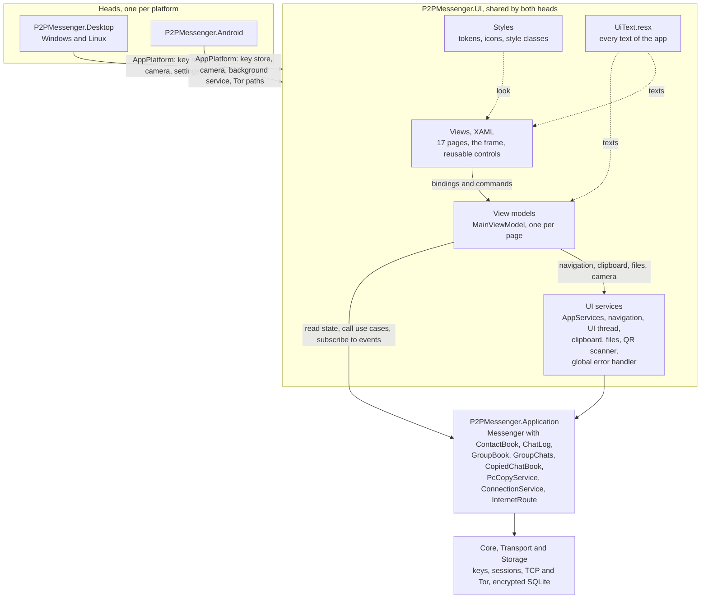
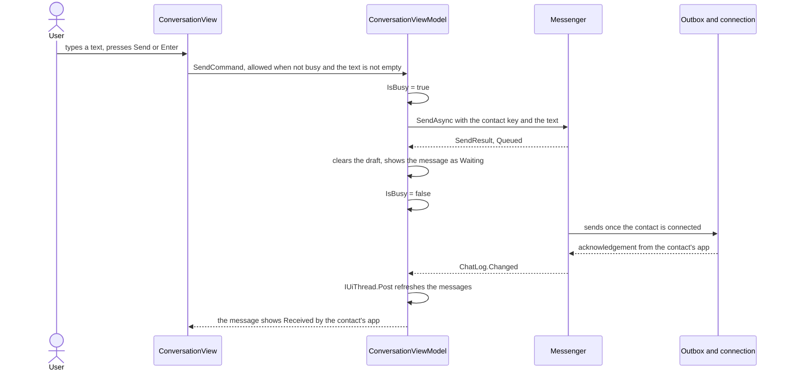
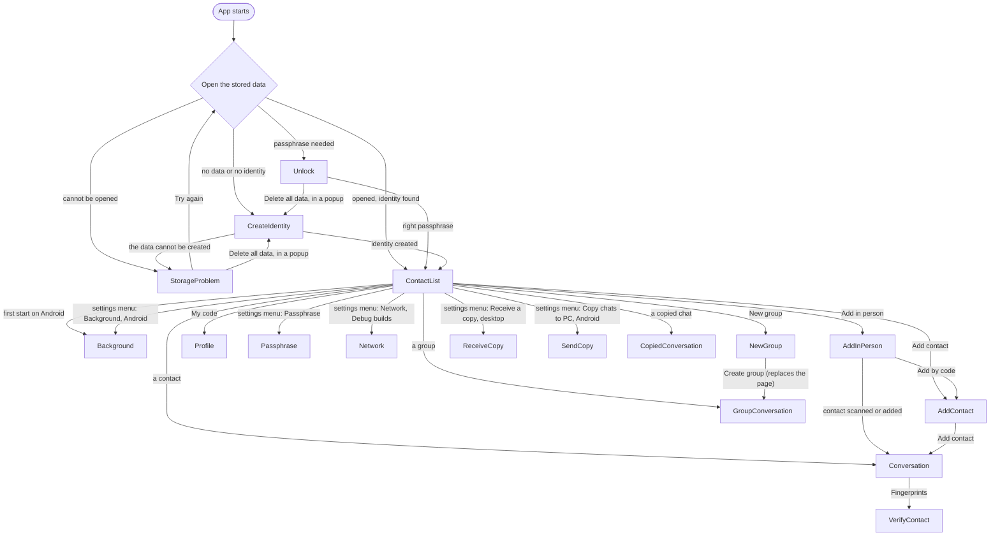

# P2PMessenger.UI: the front-end

The client of P2PMessenger is an Avalonia application written in C# with the MVVM pattern. `P2PMessenger.UI` holds everything the user sees: the views, the view models, the services that reach the platform, and every text of the app. The two heads, `P2PMessenger.Desktop` (Windows and Linux) and `P2PMessenger.Android`, start this project and provide the platform services: the key store, the camera and the background service. The front-end works with the application layer of its own process, described in [The API the front-end works with](#the-api-the-front-end-works-with).

This file is the front-end documentation: how to build, run and test the client, where each requirement of the front-end criterion is implemented, the technology stack and why it was chosen, the architecture and the navigation diagrams, state management, forms, the design system and responsive layout, error handling, loading states, logging, and the tests.

**Status:** the client has 17 pages, a frame with navigation, toast notifications and a lock screen, and it runs on Windows, Linux and Android from one code base. The pages cover creating an identity, adding contacts (in person with a QR code, or by a pasted or saved code), comparing fingerprints, the contact list with each contact's reachability, one-to-one conversations with delivery states, small groups with pass-on, per-member delivery details updated by direct or relayed signed confirmations, a member list, admin member removal, leaving a group with admin handover and read-only left/removed/ended views, copying chosen chats from a phone to a PC and reading them in a separate read-only viewer, the passphrase and the lock, deleting chats, copies and all data, the Android background service and the state of Tor. Confirmations, the member list and the delivery details are popups over the page, and the settings of the contact list are in a menu under a button. The view models and views are tested headless with Avalonia.Headless, and two or three real apps are tested together over loopback. A global error handler, a progress bar for every asynchronous action, logging of unhandled errors and a search box on the contact list are built. The look comes from one design system (colour tokens for a light and a dark theme, icons, shared styles and reusable controls), and the layout adapts from a phone to a desktop window: on a wide window the contact list stays on the left and the open chat or page is on the right, as in Telegram; on a phone the Back gesture goes one page back, and the keyboard lifts the page instead of covering the message box.

## Contents

1. [Build, run and test](#build-run-and-test)
2. [Where each requirement is implemented](#where-each-requirement-is-implemented)
3. [Technology stack and why](#technology-stack-and-why)
4. [Architecture](#architecture)
5. [Navigation and user flows](#navigation-and-user-flows)
6. [Forms and validation](#forms-and-validation)
7. [Design system and responsive layout](#design-system-and-responsive-layout)
8. [Error handling](#error-handling)
9. [Loading states](#loading-states)
10. [Logging](#logging)
11. [The API the front-end works with](#the-api-the-front-end-works-with)
12. [Tests](#tests)

## Build, run and test

Prerequisite: the .NET SDK pinned in `global.json` (10.0.404). MSBuild and the `dotnet` command restore, build, run and test the desktop client. The Android head also needs the android workload and the Android SDK; the [root README](../../README.md#prerequisites) lists them.

```
dotnet restore P2PMessenger.Desktop.slnf
dotnet build P2PMessenger.Desktop.slnf
dotnet run --project src/P2PMessenger.Desktop
dotnet test --project tests/P2PMessenger.UI.Tests
dotnet test --solution P2PMessenger.Desktop.slnf
dotnet format P2PMessenger.Desktop.slnf --verify-no-changes
dotnet build src/P2PMessenger.Android -c Debug
```

- To run two clients on one PC and see them talk, start the second with its own data folder: `dotnet run --project src/P2PMessenger.Desktop -- --data <folder>`. [Trying the app](../../README.md#trying-the-app) in the root README walks through creating two identities, adding the contacts and sending messages.
- The Android client is deployed to a connected phone with `dotnet build src/P2PMessenger.Android -t:Run`. To install an APK by hand, build it with `-p:EmbedAssembliesIntoApk=true`.
- Every push runs GitHub Actions (`.github/workflows/ci.yml`): a locked restore, the format check, a Release build with warnings as errors and all tests on Windows and Linux, and an Android build. The desktop build and the Debug APK of each run on `main` are kept as artifacts of the run.
- The app's own keys are made on the device when an identity is created and are protected by the platform's key store. The repository contains source, build and test files.

## Where each requirement is implemented

The criterion is written for web applications, so the right column also says what the web term means here.

| Requirement | Here | Status |
| --- | --- | --- |
| A client built with a modern framework (a SPA framework, Jetpack Compose, Avalonia) | Avalonia 12 with XAML views and MVVM. It is a single-window application whose pages are swapped in one frame, which is the desktop and mobile counterpart of a SPA. See [Technology stack and why](#technology-stack-and-why) | Done |
| Architecture diagram, architecture approach | [Architecture](#architecture): layers, project structure, MVVM, state | Done |
| User flows and navigation diagram | [Navigation and user flows](#navigation-and-user-flows) | Done |
| Tech stack justification | [Technology stack and why](#technology-stack-and-why) | Done |
| API documentation | [The API the front-end works with](#the-api-the-front-end-works-with): the in-process application API | Done |
| Components, containers or pages, services, modules | `Views/` (pages and the frame), `ViewModels/` (the logic of each page), `Controls/` and the reusable views, `Services/`, and the layers below. The projects of the solution are the modules | Done |
| Routing, at least 3 or 4 routes | 17 pages reached through the navigation stack of `MainViewModel`, [shown below](#navigation-and-user-flows) | Done |
| Local and global state | Local state in each view model, shell state in `MainViewModel`, application state in `Messenger`. See [State management](#state-management) | Done |
| Clear project structure: components, pages, services, models, styles | [Project structure](#project-structure): `Views/`, `ViewModels/`, `Controls/`, `Services/`, `Styles/` and `Resources/` | Done |
| Real API or mock, typed data, centralised request handling | The real application layer, typed by C# records, enums and result types; every call goes through `Messenger` and its services | Done |
| Bundler | MSBuild and the `dotnet` CLI | Done |
| Reusable and layout components, a UI library or custom components | The Fluent theme and controls of Avalonia, the frame in `MainView`, and the custom controls `Icon`, `Avatar`, `PageContainer`, `FormField`, `Dialog` and `DialogHeader`, the reusable views `QrCodeView`, `DeleteAllDataPanel` and `DeleteAllDataDialog`, and the shared styles of the [design system](#design-system-and-responsive-layout) | Done |
| Reactive or controlled forms with validation | [Forms and validation](#forms-and-validation) | Done |
| Lists, and filtering, search or sorting | The contact list with its groups, contacts and read-only copied chats, the message lists, the list of contacts to choose for a new group and the list of chats to copy to a PC. Groups, contacts and copied chats are sorted by name, and a search box on the contact list filters all three by name as you type. See [Forms and validation](#forms-and-validation) | Done |
| Responsive layout, desktop and mobile | The same pages run on desktop and Android. `PageContainer` limits the width of a page and centres it, below 560 device-independent pixels the frame switches to a compact layout, rows of buttons wrap, and the window's minimum size is 340 by 480. A screenshot test renders every main screen at desktop and phone sizes in both themes. See [Design system and responsive layout](#design-system-and-responsive-layout) | Done |
| ESLint and Prettier or another formatter | Roslyn analyzers at the `latest-recommended` level, `.editorconfig`, warnings as errors and `dotnet format --verify-no-changes` in CI | Done |
| Basic logging | [Logging](#logging): unhandled errors and the errors that commands catch are logged through `ILogger`, to the trace output and to a rolling JSON-lines log file, in Debug and Release builds | Done |
| Global error handler, clear error messages, 401, 403, 404 and 500, loading states | [Error handling](#error-handling) and [Loading states](#loading-states): a global handler with an error toast, messages from the results of the application layer, a progress bar on every asynchronous action, and the counterparts of the HTTP statuses | Done |
| At least 3 unit tests, and 1 or 2 UI or end-to-end tests | [Tests](#tests) | Done |
| No tokens or passwords in the code, no inline styles without a reason | The data key is wrapped by the platform's key store and, with a passphrase, by a key derived from it. Colours, sizes and corner radii come from the tokens in `Styles/Tokens.axaml`, and views take their look from the shared style classes | Done |

## Technology stack and why

| Concern | Choice | Why |
| --- | --- | --- |
| UI framework | Avalonia 12 | The messenger must run on Windows, Linux and Android. Avalonia runs one XAML and MVVM code base on all three and has a headless platform for automated UI tests. .NET MAUI has no Linux desktop support, and a native UI per platform would triple the UI work. The business logic is C# on .NET, so the UI shares its language and types with the layers below it |
| MVVM support | CommunityToolkit.Mvvm 8 | Source generators write the property-change code and the commands (`[ObservableProperty]`, `[RelayCommand]`), so view models stay short |
| UI kit | The Fluent theme and the controls that come with Avalonia, with a design system of its own on top: tokens, icons, style classes and custom controls | The standard controls give the behaviour and accessibility, and the design system gives them one look. The theme follows the system's light or dark mode (`RequestedThemeVariant="Default"`) |
| Language | C# on .NET 10 | Static types for the data the UI shows; nullable reference types are on and warnings are errors |
| Bindings | XAML bindings with `x:DataType` on every view | A view knows the type of its view model, so a mistyped property name is found at build time |
| State management | Plain .NET events on the application objects | See [State management](#state-management) |
| Texts | `Resources/UiText.resx` with a checked-in generated class | The texts of the app are in one file, and views bind fixed texts with `x:Static`. A test fails when the class and the `.resx` differ. The UI is English only. A page's text is a title, a label, a value, the result of an action, an error or a question that asks for a confirmation |
| QR codes | ZXing.Net (Apache-2.0) | Encodes the contact code and decodes camera frames and images on every platform |
| Build and packages | MSBuild, NuGet with central package versions and lock files | Reproducible builds; Dependabot proposes updates |
| Lint and format | Roslyn analyzers, `.editorconfig`, `dotnet format` | The counterpart of ESLint and Prettier; the build fails on a warning and CI fails on a formatting difference |
| Tests | xUnit v3 on Microsoft Testing Platform, Avalonia.Headless.XUnit, coverlet | Headless tests run the real views without a screen, in CI on Windows and Linux |

## Architecture

The approach is component-based MVVM on top of a layered application. The UI is one layer of five; a layer references the layers below it, and architecture tests enforce this.

### Layers



The UI references the application layer. A head implements the platform interfaces that the layers define (`IKeyProtector`, `IQrScanner`, `IBackgroundService` and others) and passes them in an `AppPlatform` object when it creates the `App`. The platform code stays in the heads, so the same views run on every platform.

### Project structure

| Folder of `src/P2PMessenger.UI` | Role | Examples |
| --- | --- | --- |
| `Views/` | Pages and the frame. Each page is XAML with a code-behind that calls `InitializeComponent`; the behaviour is in the view model | `ContactListView`, `ConversationView`, `GroupConversationView`, `CreateIdentityView`, `MainView` (the frame) |
| `ViewModels/` | Containers: the state, commands and validation of one page, exposed to the view by binding. They are plain C# classes. `PageViewModel` is the base class of pages | `ConversationViewModel`, `AddContactViewModel`, `MainViewModel` (the shell) |
| `Controls/` and the reusable views | Components used by several pages | `Icon` draws a stroke icon, `Avatar` a circle with a contact's initials, `PageContainer` limits and centres the width of a page and has a layer for popups, `FormField` puts a label over a field, `Dialog` is a popup over a page with a dimmed background (with `IsMenu` it is a menu under a button, see below) and `DialogHeader` its icon and title; `QrCodeView` draws a QR code (the code page, the in-person page and the receive-copy page); `DeleteAllDataPanel` is the button that starts deleting all data and `DeleteAllDataDialog` its confirmation popup and progress (the contact list, the lock page and the stored-data page) |
| `Styles/` | The design system, see [Design system and responsive layout](#design-system-and-responsive-layout) | `Tokens.axaml`, `Icons.axaml`, `Typography.axaml`, `Controls.axaml`, `Surfaces.axaml`, `Components.axaml` |
| `Services/` | The services behind interfaces that view models use: `INavigationService`, `IUiThread`, `IClipboardService`, `ICodeFileService`, `IQrScanner`, and `AppServices`, which opens the stored data and starts the messenger. `GlobalErrorHandler` catches what no command catches | `AppServices`, `TopLevelServices`, `AvaloniaUiThread`, `GlobalErrorHandler` |
| `Qr/` | Encoding and decoding of QR codes | `QrMatrix`, `QrDecoder` |
| `Resources/` | The texts | `UiText.resx`, `UiText.Designer.cs` |

The views of the pages are 17: `StorageProblem`, `CreateIdentity`, `ContactList`, `Profile` (my code), `AddContact`, `AddInPerson`, `Conversation`, `NewGroup`, `GroupConversation`, `ReceiveCopy` (PC), `SendCopy` (phone), `CopiedConversation` (read-only), `VerifyContact`, `Network` (Debug builds), `Unlock`, `Passphrase` and `Background`. `MainView` holds a `DataTemplate` for each page view model, so a page appears when its view model becomes `MainViewModel.CurrentPage`: navigation is view-model first.

Pages are created by the `Pages` factory, which knows the services; a view model receives what it needs through its constructor.

### State management

There are three kinds of state.

- **Local state** is in the view model of a page: `[ObservableProperty]` fields such as the text of a form field, `IsBusy` and the error message. The page's commands change it and the view reads it by binding.
- **Shell state** is in `MainViewModel`: the stack of pages, the current title, the toasts (`ToastItems`, from `ToastCenter`), the width class (`IsWide`), the height of the keyboard (`KeyboardInset`) and whether the app is locked.
- **Application state** is in `Messenger`, the single source of truth: the contacts (`ContactBook`), the chats and delivery states (`ChatLog`), the connections and reachability of each contact (`ConnectionService`) and the internet route (`InternetRoute`). They are loaded from the encrypted database when the app starts and raise .NET events when they change. A view model subscribes when its page is shown (`OnShown`), unsubscribes when it is hidden (`OnHidden`) and moves each event to the UI thread with `IUiThread.Post`, because the events come from network threads.

Application state lives below the UI: on Android the background service keeps receiving and saving messages while no screen exists, and the tests run the same objects without Avalonia. The UI reads that state directly.

The sequence of sending a message shows the three kinds working together.



## Navigation and user flows

`MainViewModel` implements `INavigationService` with a stack of page view models: `Push` opens a page above the current one, `Open` is what the contact list uses (it is `Push` on a narrow window, and on a wide one it replaces the page that is open beside the list), `Replace` swaps the current page, `ResetTo` clears the stack and `GoBack` returns, which the header's Back button and the system's Back gesture call. Back is hidden on the first page of the stack. A page's `OnHidden` and `OnShown` run when it is covered and uncovered; `MainViewModel` keeps the set of pages that are visible (`SyncShown`), and on a wide window the contact list counts as visible as long as the app is unlocked.



- Every page except the first has a Back button that returns to the page below it.
- **Lock:** after 5 minutes in the background, or when "Lock" in the header is pressed (when a passphrase is set), the page is hidden behind the unlock screen. The stack is kept, the app keeps receiving messages, and the same page is shown again after the passphrase is entered.
- **Popups:** a question or a short list that belongs to the open page appears as a popup over it, with the page dimmed behind. Deleting a chat, a waiting message, a copied chat or all data, removing a member, leaving a group and quitting the app ask in a popup. The member list and the delivery details of a group message are popups too. A popup does not move the page and does not open another page; Cancel, Close, the Esc key or a click outside the popup closes it. See [Design system and responsive layout](#design-system-and-responsive-layout).
- **Settings menu:** the contact list has a button with sliders at the right end of its first row, beside "Add in person", so the settings are reachable without scrolling past the contacts. It opens a menu under the button with "Passphrase" (when the data can have one), "Background" (Android), "Copy chats to PC" (Android), "Receive a copy" (desktop), "Network (debug)" (Debug builds) and, after a separator, "Delete all data". The menu closes when an item is chosen, on Esc, on a click outside it and when the page is left, and it does not dim the header.
- **Wide window:** from 900 device-independent pixels the contact list is a pane of 380 on the left with its own header ("Contacts" and "Lock") and the page that is open is on the right, with its own header (Back and the title); an empty right side shows only an icon. Choosing a contact, a group or a copied chat, or any item of the settings menu, replaces the page on the right, the open chat is marked in the list, and Back closes the page on the right and leaves the list. The pages that are not on top of the contact list (identity creation, unlock, the stored-data problem) fill the window. The window opens at 1100 by 780.
- **Back gesture and Back key:** the system's Back (the edge swipe on Android, Alt+Left or the mouse's Back button on a desktop) closes an open popup or menu first, then goes one page back; on the first page, and while the app is locked, it is left to the system.
- **Toasts:** what the app says about something that has happened (a contact is added, the code is copied or saved, a passphrase is set, changed or removed, a chat or a message is deleted, a member is removed, all data is deleted, an unexpected error, and that nothing is saved on this device) appears as a toast at the bottom of the window, over the page, so it never moves the page. A toast goes away by itself after 6 seconds (10 for an error), has a button that dismisses it, and the "nothing is saved" toast stays until it is dismissed. Toasts are hidden while the app is locked. Messages about a form's input, and the states that belong to a page (waiting, key not compared, progress), stay on the page.

The main user flows, step by step:

1. **First start.** Create an identity with a display name, and optionally a passphrase and whether to use Tor. The app opens the contact list.
2. **Add a contact in person.** Both people open "Add in person". Each screen shows a QR code, and "Scan their code" reads the other's with the camera. The contact is added at once with its key marked as checked by you, and the conversation opens.
3. **Add a contact from a code.** Copy "My code", save it as a text file or as a QR image, and pass it on through another messenger. The other person opens "Add contact", pastes the code or opens the file or the image, reads the preview with the name and fingerprint, and chooses "Add contact". The contact is marked "key not compared".
4. **Compare fingerprints.** In the conversation, "Fingerprints" (or "Compare fingerprints" in the notice about an uncompared key) opens the two fingerprints of the pair; "They match" marks the key as checked by you.
5. **Chat.** Write and send. A message shows "Waiting" until the contact's app confirms it, then "Received by the contact's app". If the contact is not connected, the message waits, also across restarts, and its bubble offers "Delete" until the contact's app confirms it. With many contacts, type part of a name in the search box on the contact list to narrow it.
6. **Protect and delete.** Set, change or remove a passphrase; delete one chat, one waiting message or all data after a confirmation.
7. **Create a group and chat in it.** "New group" (shown once there is a contact) lists the contacts whose first connection has succeeded; name the group, tick the members and choose "Create group". The group's page opens and the group appears on the contact list of every member. Until every member has joined, the page says who has not joined yet, and a member who still lacks some members as contacts sees them named with their fingerprints and adds them by the usual code exchange; their app then joins by itself. Once everyone has joined, the message box appears. Each of the user's group messages shows "Waiting", then "Received by N of M members' apps"; selecting the state opens a popup showing each other member sorted alphabetically as "Waiting" or "Received by their app", and "Delete message" while no member's app has it. Both the summary count and each member's line update live when a signed confirmation arrives directly or through another member. When a member missed group messages while away, other members' apps pass the missed signed messages on when they meet, and they appear under the original author's name and increment the group's unread count. "Delete chat" on the group's page removes the group's messages from this device after a confirmation, while the user stays a member and other members' apps keep their copies and can pass them on; a group message of the user's own that no member's app has yet can be deleted from its details popup, like a waiting one-to-one message. "Members (N)" opens a popup listing active members (with the "Admin" badge on the current authority and each member's fingerprint): the admin sees a "Remove" button beside each other member that asks in a second popup, and any active member sees "Leave group" (when the current admin leaves a group with two or more remaining members, the confirmation popup includes a picker for the next admin). Once the user leaves, is removed, or is the only remaining member, the message input hides, a read-only banner states which of the three it is, the contact list labels the group "You left", "Removed" or "No other members", and the question of "Delete chat" says that the deletion applies to this device only.
8. **Copy chosen chats to a PC.** On the desktop contact list, "Receive a copy" displays a one-time pairing QR code (never placed on the clipboard) and waits for the phone on the same Wi-Fi network; leaving the page closes the listening port. On Android, "Copy chats to PC" scans the PC's QR code with the camera, connects, lists all added one-to-one chats and created groups with their message counts (disclosing "newest X of Y messages" if a chat exceeds the per-conversation limit), and copies the ticked conversations. Copied chats appear on the PC under a separate "Copied chats (read-only)" section below its own chats, open in `CopiedConversationView` marked as read-only with no reply box, update only when copied again, and offer "Delete copy" with confirmation without touching the phone.

## Forms and validation

Forms are view models with bound properties. A command's `CanExecute` disables its button while the input is invalid or the page is busy, and the view model checks the input again when the command runs and shows the reason in an error text under the form. Validation rules live in the application layer, so the tests and every head share them.

| Form | Fields | Validation and feedback |
| --- | --- | --- |
| Create identity | Name, passphrase and its repeat, use Tor | "Create" is disabled while the name is empty or the page is busy. A name of more than 64 bytes or with control characters is refused with a message. A passphrase needs at least 12 characters and a matching repeat. An empty passphrase is allowed, and a one-line warning says what that means on this device |
| Passphrase | Current, new and repeated passphrase | The same rules; a wrong current passphrase and a key store that refuses are reported |
| Unlock | Passphrase | A wrong passphrase says so and can be tried again |
| Add contact | Pasted code, file or image | "Check code" is enabled once there is text. The preview shows the name and fingerprint for a code that can be added. A text that is not a code, a damaged code, an unsupported version, one's own code, keys already in use and an already added contact each have their own message. A code that looks like an existing contact with a new identity, or with new connection keys, gets a warning and a separate button. A file larger than the limit and an image with no code are refused |
| Add in person | Camera scan | A device without a usable camera says so and offers the text or file code |
| Conversation | Message text | "Send" is disabled while the text is empty or a send is running; Enter sends and Shift+Enter starts a new line on a desktop (on a phone the Enter key starts a new line). A text that is too long, a contact that cannot be sent to or is not a contact is reported |
| New group | Group name, members | "Create group" is disabled while the name is empty, no member is ticked or a create is running. A name of more than 64 bytes or with control characters, no members, too many members and a member who is no longer an added contact each have their own message; a page with no contact to invite says so |
| Group conversation | Message text, member removal, leave | The message box is shown only once every member has joined and while the user stays an active member with at least one other active member. "Send" is disabled while the text is empty or a send is running; Enter sends and Shift+Enter starts a new line on a desktop. A text that is too long for a group is reported. "Members (N)" opens the member popup with fingerprints, admin badge, admin-only "Remove" confirmation per member and "Leave group" confirmation (requiring a chosen successor admin when the admin leaves with two or more other active members). "Delete chat" and "Delete message" ask first; "Delete message" is offered only while no member's app has the message, and if one confirms it in the meantime the page says that it was not deleted; inactive groups use the read-only local deletion prompt |
| Receive a copy | One-time QR pairing code (desktop) | Displays the pairing QR code without exposing the secret to the clipboard, reports when no local Wi-Fi network is available or listening fails, shows live connection and transfer progress, and offers "Start again" after completion or an interrupted connection |
| Copy chats to PC | Camera QR scan, conversation selection (Android) | Validates the scanned QR pairing code (`NotAPairingCode`, `UnsupportedVersion`, `Damaged`), reports camera errors or when the PC is unreachable on the same Wi-Fi network, discloses "newest X of Y messages" when a chat exceeds the per-conversation cap, disables copying until connected with at least one conversation ticked, shows transfer progress, and offers retry if the connection breaks mid-copy |
| Copied conversation | Read-only viewer (PC) | Shows the read-only copy notice and timestamp with no message input; "Delete copy" asks for confirmation before removing only the PC's copy |
| Contact list | Search box | Contacts and groups are one list (`ContactListViewModel.Chats`) ordered by the time of the latest message of the chat, sent or received, with the newest on top; chats without a message follow, by name. Shown once there is a contact, group or copied chat. It filters groups, contacts and copied chats by name as you type, ignoring case and surrounding spaces, and "Clear" empties it. A search with no match says "No contact matches your search." and is told apart from the empty list. An item added while a search is active appears if it matches. The filter works on the lists that the app holds in memory (decrypted when it started) |

## Design system and responsive layout

`App.axaml` loads the tokens and icons as resources and the four style files as styles, after the Fluent theme, so every view uses the same look and none sets colours by hand.

| File or class | What it holds |
| --- | --- |
| `Styles/Tokens.axaml` | Colour brushes for the Light and Dark theme variants (background, surface, outline, text, accent, success, warning and danger with a soft and a text shade, message bubbles, disabled text, the scrim behind a popup), the card and popup shadows, corner radii and font sizes. Views refer to them with `DynamicResource`, so the app follows the system theme. The accent also sets the Fluent palette |
| `Styles/Icons.axaml` | 28 stroke icons on a 24-unit grid as `StreamGeometry` (the Feather set, MIT-licensed) |
| `Styles/Typography.axaml` | Text classes: `hero`, `apptitle`, `title`, `heading`, `section`, `label`, `muted`, `caption`, `error`, `mono` and `centered` |
| `Styles/Controls.axaml` | Button variants `primary`, `danger`, `quiet`, `row`, `chip`, `menuitem`, `icononly` and `iconic`, with hover, pressed and disabled states, and the look of text boxes, check boxes, combo boxes, progress bars and scroll bars. `iconic` shows the icon of `Icons.Glyph` beside the text while `Button.Content` stays plain text |
| `Styles/Surfaces.axaml` | Panels: `card`, `notice` with `success`, `warning`, `danger` and `plain`, `toast`, `master`, `appbar`, `pill` and `badge`, status `dot`, message `bubble` with `own` and `theirs`, `qr`, `fingerprint`, `iconCircle`, `heroIcon`, the popup card `dialog` with its row of buttons `dialogActions`, the `separator` line of a menu, and the `scrim` that dims the header |
| `Styles/Components.axaml` | The templates of `PageContainer`, `FormField`, `Dialog` and `DialogHeader`, and the colour classes of `Icon` |

The pages use these pieces: the contact list shows each contact as a row with an `Avatar` (the colour comes from a hash of the name, so a contact keeps it), a status dot, a key-check line and an unread badge; a conversation shows message bubbles with the author and time; the notices carry an icon and a colour for their kind; the first run and the lock screens have a welcome icon and a card.

**Popups.** A `Dialog` is a layer over a page: a dimmed background and a card in the middle, with a `DialogHeader` (an icon in the colour of the action and a title), the text, and buttons on the right. It sits in the page's own tree, as the last child of the page's root, or in the `Overlay` of a `PageContainer`, and is shown while its `IsOpen` is bound to a flag of the view model (`IsConfirmingDeleteChat`, `IsMembersShown`, `IsConfirming` of the delete-all panel and so on), so the open popup is part of the view model's state and the tests read it like any other state. Its `CancelCommand` runs on Esc and on a click outside the card, so a popup closes the way its Cancel or Close button does, and not while the action runs. A popup about one message or one member is bound to the view model that the page's current item has: `ConversationViewModel` gives `DeletingMessage` and `GroupConversationViewModel` gives `DetailsMessage`, `DeletingMessage` and `RemovingMember`, which follow `IsDetailsShown`, `IsConfirmingDelete` and `IsConfirmingRemove` of the items. Popups can stack: the removal question appears over the member list. A `Dialog` raises a routed event when it opens or closes, and `MainView` uses it to dim the header with the `dialogOpen` class, and, on a wide window, the pane that the popup is not in (`MasterShade`, `DetailShade`), so the popup covers the whole window. The popup is 440 device-independent pixels wide at most (520 for the member list) and takes the width of the window on a phone.

**Menu.** A `Dialog` with `IsMenu` is the settings menu of the contact list. Its scrim is transparent, so a click outside the card closes it without dimming anything, and `MainView` does not count it for the `dialogOpen` class. `AnchorWidth` limits and centres the area in which the card sits (688, the width of the page's column), and the style puts the card at the top right of that area, under the button, with the margins of the page's padding (`0,64,24,0`, and `0,58,14,0` in the compact layout). `ContactListViewModel.IsMenuOpen` is bound to `IsOpen`, `OpenMenuCommand` opens it, `CloseMenuCommand` is its `CancelCommand`, and each item's command closes it first.

**Responsive layout.** A page is a `PageContainer`: a scrolling area with a content column of at most 688 device-independent pixels (a page can set another limit), centred in wide windows. `MainView` sets the `compact` class on itself when its width is below 560 (`MainView.CompactWidth`). The compact style reduces the padding of pages and the chat, and button rows are `WrapPanel`s that break into lines. `MainView` also sets `MainViewModel.IsWide` when its width is at least 900 (`MainView.WideWidth`), which splits the window into the contact list and the open page (see Navigation). `QrCodeView` has no fixed size, so it scales with the column. The window opens at 1100 by 780 and cannot be smaller than 340 by 480. The same views run on a phone and on a desktop.

**Keyboard on a phone.** Avalonia does not move the page when the on-screen keyboard opens, so `MainView` listens to `TopLevel.InputPane` (`OccludedRect`), keeps the height of the keyboard in `MainViewModel.KeyboardInset` and gives the whole frame that bottom margin. The message box, and the toasts, then sit above the keyboard. The list of messages sticks to its end (`StickToBottom`): while the reader is at the end it stays at the end when a message arrives or the keyboard shrinks the list, and a reader who has scrolled up is not moved. The Enter key sends on a desktop through `SendOnEnter`, which runs the send command on Enter without Shift.

**Checking the look.** `ScreenshotTests` renders 21 screens (first run, unlock, contacts with and without contacts, the settings menu, a conversation, a group, add contact, add in person, my code, fingerprint comparison, new group, passphrase, background settings, the stored-data problem, and the popups for delete all data, delete chat, message details, the member list and removing a member) at 900 by 760 (the wide layout, with the contact list on the left) and 360 by 720, in the light and the dark theme. It runs when the `P2PM_SCREENSHOTS` environment variable names a folder, writes one PNG for each combination there, and skips itself otherwise. `P2PM_SCREENSHOT_VARIANT` (for example `phone-dark`) and `P2PM_SCREENSHOT_SCREENS` (for example `members`) narrow the run. `DesignSystemTests` check the avatar's initials and colours, that the light and dark tokens define the same keys and resolve to brushes, the compact switch at the breakpoint and the padding it gives, the icon in an `iconic` button and the width limit of `PageContainer`. `DialogTests` check that a popup shows only while open, closes on Esc and on a click outside the card but not on a click inside it, dims the header while open and stops when its page is left, and that the details and the deletion popups of a message follow the message's state, and that the settings menu opens under its button with its right edge on the button's, does not dim the header, closes on Esc, on a click outside, when an item is chosen and when the page is left.

## Error handling

The application layer returns expected failures as result types and enumerations, and each one has its own text in `UiText.resx`, so the UI names the reason.

| Situation | How it is handled |
| --- | --- |
| Invalid input | Results such as `CodeCheckOutcome`, `SendOutcome` and `PassphraseProblem`; the message is shown on the page |
| Stored data cannot be opened (key store locked or missing, data damaged, newer version) | The "Stored data" page names the reason and offers "Try again" or "Delete all data". The stored data stays as it is until the user chooses "Delete all data" |
| The app fails to start | A message in the frame |
| An operation in a page fails with an exception that the page expects (file reading, passphrase change, deletion, background settings) | The command catches it, resets `IsBusy`, shows a message from `UiText.resx` on the page and logs it at the Warning level: the page, the operation and the exception's type, never its message (`ReportFailure` in `ViewModelBase`, `FailureLog`). Which exceptions count as failures is decided by `Failures` in `P2PMessenger.Core`, one predicate for the whole solution: cancellation and out-of-memory pass through |
| An exception that no command catches (for example a failed database write while sending a message, or a bug) | The global handler, below. Every command resets `IsBusy` in a `finally` block, so the page is usable again |
| Something that changes state succeeds | The message says what was confirmed: "Bob is added."; "Received by the contact's app" appears after an authenticated acknowledgement |
| Failed connection to a contact | The conversation says that the contact's device was heard nearby and that its app did not answer or did not accept the connection |

The counterparts of the HTTP statuses are the results above: "not found" is a key that is not in the contact book, "forbidden" is a caller that is not a contact (refused in the transport), and "server error" is an unreadable or damaged database, which has its own page.

**The global handler** is `GlobalFailureHandler` in `P2PMessenger.Application` (see the [root README](../../README.md#back-end)), so it does not depend on the UI. The front-end's `GlobalErrorHandler` in `Services/` is its adapter. `App` makes one `GlobalFailureHandler`, gives it to the messenger as `MessengerSetup.Failures`, so that the connections, the discovery and the delivery report to it the unexpected failures that they catch in their background work, and installs the adapter for both lifetimes (desktop window and Android activity) when the shell view model exists. Failures reach the handler from four kinds of source:

- `Dispatcher.UIThread.UnhandledException`, the adapter's own hook: the exception of a command that throws, a handler of a service event, or any other code that runs on the UI thread. The toolkit's asynchronous commands rethrow on the UI thread, so an exception in a command ends here. The adapter marks it handled, and the app keeps running.
- `TaskScheduler.UnobservedTaskException`, a hook of the back-end handler: a failed task that nobody awaited. The handler marks it observed.
- `AppDomain.UnhandledException`, a hook of the back-end handler: an exception that is ending the process. It is logged.
- The connections, the discovery and the delivery, through `IFailureSink`. They log their own failure only when no handler was given.

For a failure on the UI thread and for a failed task the adapter shows an error toast, "Something went wrong, so the last action may not have finished. Try it again; if it keeps failing, restart the app.", with a button that dismisses it. The failures of the components and the end of the process are logged and counted without a toast. The toast has the error colours and is hidden while the app is locked. `OutOfMemoryException` passes through and the app ends. The handler reports each exception once: the dispatcher's task for a failed callback carries the same exception, and the task scheduler's event fires for it when the garbage collector finalizes that task, so the handler remembers the exceptions it has reported. It logs the type of the exception and where it came from (see [Logging](#logging)). The Tor switch ignores `ObjectDisposedException` (the app is quitting) and passes every other exception to the handler.

`GlobalErrorHandlerTests` check the notice and its dismissal, the log line, that an exception thrown by a real asynchronous command reaches the handler through the dispatcher and is reported once, even after a forced garbage collection, that out-of-memory passes through, that a failure reported by a component or by the end of the app shows no notice, and the Tor switch. `GlobalFailureHandlerTests` (Application) and `FailureReportingTests` (Integration) check the back-end side. `CommandFailureLogTests` check that a command that catches an error still shows its message and writes one Warning line with the page, the operation and the exception's type, and not the exception's message.

## Loading states

Every asynchronous command sets `IsBusy` while it runs. That disables its buttons, so a second press waits for the first to finish, and shows an indeterminate `ProgressBar` next to the action. The bar is visible exactly while `IsBusy` is true:

- on the pages of identity creation, passphrase, unlock, stored-data problem, adding a contact (by code and in person), my code, fingerprint comparison, background settings, a new group, the conversation, the group conversation (sending a message, removing a member, leaving the group), receiving a copy and copying chats to a PC;
- in the popups that delete a chat, a waiting message, a copied chat or all data, remove a member or leave a group;
- next to the Tor switch on the contact list, and in the frame while the app starts.

Pages whose action takes noticeable time also show a text beside the bar: "Creating your keys…", "Checking the passphrase…", "Saving the passphrase…", "Deleting…", "Opening the stored data…" and "Starting…". The contact list also shows how far the connection to Tor has got. Lists show their data directly: it is local and loaded into memory at start. `BusyBarTests` check that each bar follows `IsBusy` of its view model.

## Logging

The application and transport layers log through `ILogger` with source-generated messages whose parameters are connection numbers, enumeration values, durations and the listening port. The UI layer logs through the same factory: the back-end `GlobalFailureHandler` writes one Error line, "Unexpected failure of type {type} in {source}", where the source is the UI thread, a background task, the app domain, the connections, the discovery, the delivery, groups or PC copy, and `FailureLog` writes one Warning line, "{page} could not finish {operation}: {type}", for an error that a command catches. The loggers receive the type name, the source, the page and the operation as plain values.

The factory writes to two sinks. The .NET trace output (`TraceLoggerFactory`), which a debugger, a tool such as DebugView or, on Android, logcat shows, gets Information and above in a Debug build and errors in a Release build. A JSON-lines log file in the `logs` folder of the data folder (`FileLoggerFactory`, wired in `AppLoggers`) gets Information and above in both builds, rolls at 1 MiB and keeps 3 files. It writes only plain values and never an exception's message or stack. Its format, its location on each platform, how to read it and what never gets in are described in the [root README](../../README.md#logs).

## The API the front-end works with

The application is one program per device. The front-end calls the application layer in the same process through `Messenger`; the application layer in turn exchanges encrypted frames with the contacts' apps, and the layers below it own the sockets and the database.

| Object | Calls the UI uses | Returns |
| --- | --- | --- |
| `AppServices` (UI project) | `OpenLocalDataAsync`, `CreateLocalDataAsync(passphrase)`, `UnlockLocalDataAsync(passphrase)`, `SetPassphraseAsync`, `ChangePassphraseAsync`, `RemovePassphraseAsync`, `StartMessengerAsync(identity)`, `DeleteAllDataAsync`, `SetTorAsync(on)`, `QuitAsync`; platform role flags `CanSendPcCopy` (Android) and `CanReceivePcCopy` (desktop) | `LocalDataResult` with a `LocalDataStatus` (`Opened`, `NotCreated`, `PassphraseNeeded`, `WrongPassphrase`, `PassphraseRequired`, `PassphraseNotAccepted`, `Failed`) and a problem; `PassphraseChangeResult` |
| `IdentityService` | `LoadAsync`, `CreateAsync(name)` | `CreateIdentityResult` with the identity or an error |
| `Messenger` | `SendAsync(contactKey, text)`, `DeleteChatAsync(contactKey)`, `DeleteWaitingAsync(contactKey, id)`, `CreateGroupAsync(name, contactKeys)`, `RemoveGroupMemberAsync(groupId, memberKey)`, `LeaveGroupAsync(groupId, successorKey)`, `SendToGroupAsync(groupId, text)`, `DeleteGroupChatAsync(groupId)`, `DeleteWaitingGroupMessageAsync(groupId, id)`, `DeleteCopiedChatAsync(origin)`; properties `Identity`, `Contacts`, `Chats`, `Groups`, `GroupChats`, `CopiedChats`, `PcCopy`, `Connections`, `InternetRoute` | `SendResult` with a `SendOutcome` (`Queued`, `Empty`, `TooLong`, `NotSendable`, `NotAContact`, `WaitingForFirstConnection`); `CreateGroupResult` with a `CreateGroupOutcome` (`Created`, `NameNotValid`, `NoMembers`, `TooManyMembers`, `NotAnAddedContact`); `RemoveMemberResult` with a `RemoveMemberOutcome` (`Removed`, `EndedGroup`, `NotAGroup`, `NotAuthorized`, `NotAMember`, `CannotRemoveSelf`, `NotActive`); `LeaveGroupOutcome` (`Left`, `NotAGroup`, `NotActive`, `SuccessorRequired`, `InvalidSuccessor`); `GroupSendResult` with a `GroupSendOutcome` (`Queued`, `Empty`, `TooLong`, `NotSendable`, `NotAGroup`, `NotCreatedYet`, `Left`, `Removed`, `Ended`) |
| `ContactBook` | `All`, `TryGet(key)`, `Check(text)`, `AddAsync(check)`, `SetKeyComparisonAsync(key, comparison)`, event `Changed` | `CodeCheck` with a `CodeCheckOutcome` (`New`, `NewConnectionKeys`, `LooksLikeContact`, `AlreadyContact`, `OwnCode`, `KeysInUse`, `NotACode`, `UnsupportedVersion`, `Damaged`); `AddContactResult` |
| `ChatLog` | `MessagesWith(key)`, `WaitingFor(key)`, `UnreadCount(key)`, `MarkRead(key)`, event `Changed` | `ChatMessage` with a `DeliveryState` (`None`, `Waiting`, `Received`) |
| `GroupBook` | `All`, `TryGet(groupId)`, `MembersToAdd(group)`, event `Changed` | `Group` with its record history, `AuthorityKey`, `LeaveProofs`, its members (`GroupMemberStatus` with `GroupMemberState` `Member`/`Removed`/`Left` and `MemberJoin` `NotYet`/`Joined`/`JoinedAnotherList`), `IsAuthority`, `CanRemoveMembers`, `CanLeave`, `NeedsSuccessorToLeave` and `GroupState` (`Joining`, `WaitingForMembers`, `Created`, `ListsDiffer`, `Left`, `Removed`, `Ended`) |
| `GroupChats` | `MessagesIn(groupId)`, `UnreadCount(groupId)`, `MarkRead(groupId)`, event `Changed` (a message added, updated or removed, or the chat cleared) | `GroupChatMessage` with its author, text, times and, for the user's own message, `Deliveries` (per-member `DeliveryState`), `ReceivedCount` of `RecipientCount` and `CanBeDeleted` |
| `CopiedChatBook` | `All`, `TryGet(origin)`, event `Changed` (`Saved` or `Deleted`) | `CopiedConversation` with its `Origin`, `Title`, `CopiedAt` and read-only `Messages` |
| `PcCopyService` | `ListCandidates()`, `TryParsePairingCode(text)`, `StartReceivingAsync(ct)`, `ConnectAsync(code, ct)` | `CopyCandidate` list, `StartReceiveResult` with `PcCopyReceiver`, `PcCopyConnectResult` with `PcCopySender`, `PcCopyReceiveResult`, `PcCopySendResult` |
| `ConnectionService` | `ReachabilityOf(key)`, `IsConnected(key)`, `DialStatusOf(key)`, `TorStatusOf(key)`, `Network`, `ListeningPort`, event `Changed` | `Reachability` (`NotReachable`, `Nearby`, `Tor`) and the status types |
| `InternetRoute` | `Status`, `IsOn`, `IsInBuild`, `SetEnabledAsync(on)`, event `Changed` | `InternetRouteStatus` |

Example, sending a text to a contact:

```
SendAsync(contactKey, "See you at 6")  ->  SendResult { Outcome = Queued }
SendAsync(contactKey, "")              ->  SendResult { Outcome = Empty }
```

A queued message is kept in the encrypted database at once and shows "Waiting" until the contact's app acknowledges it; `ChatLog.Changed` then tells the page to refresh it.

The platform services that the UI calls through interfaces, which each head implements, are `IClipboardService`, `ICodeFileService`, `IQrScanner`, `IKeyProtector`, `IBackgroundService` and the settings store.

## Tests

The tests are in `tests/`, one project per layer. Run the UI ones with `dotnet test --project tests/P2PMessenger.UI.Tests`, or everything with `dotnet test --solution P2PMessenger.Desktop.slnf`. Every run also writes a coverage report into `TestResults`.

**Unit tests of key components:**

- `ContactBookTests`, `ChatLogTests`, `IdentityServiceTests`, `OutboxTests`, `PassphrasePolicyTests`, `AppLockTests`, `CopiedChatBookTests` and `PcCopyServiceTests` in `tests/P2PMessenger.Application.Tests` test the services that the view models call: code checks, the message log and delivery states, identity creation, the outbox, the passphrase rules, the lock, copied chats and PC copy sessions.
- `tests/P2PMessenger.UI.Tests` tests the pages with Avalonia.Headless. A test creates the real view and view model with the harness in `UiHarness`, which runs a real messenger with in-memory data, runs commands, and reads what the controls show. It has one test class for each page or group of pages: `MainViewTests` (the frame and navigation), `ContactListViewTests` (reachability, unread counts, the search box), `ConversationViewTests`, `GroupViewTests` (a new group, the members to add, the members not yet joined, the receipt count, per-member delivery details in a popup sorted alphabetically and live-updating on relayed signed confirmations, a passed-on message with its original author and unread count), `GroupMembershipViewTests` (the member popup, admin badge, removal popup and busy bar, leave popup and successor picker, non-admin view, read-only left/removed/ended banners, inactive delete-chat prompts, contact list states), `PcCopyViewTests` (role buttons, receiving a copy with real rendered QR capture and decode and zero clipboard/text exposure, close on leaving, scanning and copying chosen chats, truncated candidate disclosure, read-only viewer with no reply field, search filter and deleting a copy), `AddContactViewTests`, `AddInPersonViewTests`, `VerifyContactViewTests`, `PassphraseViewTests` (identity creation with and without a passphrase, the lock, the passphrase page), `StorageProblemViewTests`, `DeletionViewTests`, `GroupDeletionViewTests` (deleting a group chat and a waiting group message), `BackgroundViewTests`, `ProfileViewTests`, `NetworkViewTests`, `InternetRouteViewTests`, `TorSwitchViewTests`, `GlobalErrorHandlerTests` (the global handler and its toast), `SplitLayoutAndToastTests` (the contact list beside the open page, the resize across the breakpoint, toasts that do not move the page, expire, stay when sticky and are limited), `ConversationBehaviorTests` (Enter and Shift+Enter, the list sticking to its end, the keyboard lifting the message box, the Back request), `BusyBarTests` (the progress bars), `DialogTests` (the popups) and `DesignSystemTests` (the design system; `ScreenshotTests` writes its screenshots on request).
- `UiTextTests` checks that the generated text class has exactly the names of the `.resx` and that no text is empty. `QrCodeTests` and `QrImageTests` check the QR code encoding and decoding.

**UI and end-to-end tests:**

- The headless UI tests render the real window. `QrImageTests` and `PcCopyViewTests` draw the code page, the in-person page and the receive-copy page, capture the rendered frame and decode the QR code from the picture (`Profile_TheQrCodeOnTheScreen_IsReadable`, `AddInPerson_TheQrCodeOnTheScreen_IsReadable`, `ReceiveCopyView_RendersReadablePairingQrCodeWithoutClipboardSecretAndClosesWhenHidden`); `MainViewTests` creates an identity through the page and connects a second, real peer to show the toast.
- `tests/P2PMessenger.Integration.Tests/AppSlice` runs two or three complete apps (storage, application, transport) over loopback. They create identities, add each other by codes, find each other, chat, restart and continue, and delete data (`AppSliceTests`, `DeliveryTests`, `RestartTests`, `PassphraseTests`, `DeletionTests`); `GroupTests` runs three apps that create a group and chat in it, an invitee who joins once the missing members are added, a group message that waits for a member across restarts, a deleted group chat that stays deleted after a restart while the user's numbering goes on, forged invitations and group messages from outsiders, and a creator who sent different member lists; `GroupPassOnTests` runs three apps where an absent member receives missed group messages through a third member (also across restarts and without duplicating when the author returns), relays newly arrived messages over open sessions via a short delayed summary re-exchange with zero duplicate copies when all members are connected, verifies own messages go out before summaries, ignores unknown-author summary entries, keeps deleted chats from being passed back, refuses forged, re-signed or outsider messages and invalid summaries, and rate-limits repeated summaries; `GroupDeliveryTests` runs three or four apps over loopback verifying relayed signed group acknowledgements across passer restarts and multi-hop relays (both across reconnections and over already-open sessions), permanent deletion from the passer once confirmed by the author, deleted-chat confirmation via seen IDs, and rejection of unsigned or forged group acknowledgements; `PcCopyTests` runs a phone and PC over loopback through saving, re-copying, restarts, deleting a copy, verifying stolen PC database files are unreadable without credentials (with and without a passphrase), verifying zero private keys appear in sent data or the PC copy, and refusing rogue callers silently.
- `tests/P2PMessenger.E2E.Tests` runs the whole app the way a person uses it: each simulated device is the real main window on the real view models, a real messenger, an encrypted SQLite database in a temporary folder and a TCP listener on loopback, and a test finds controls in the rendered window and drives them only with mouse clicks and typed text, then reads what the window shows. `ChatTests` has two people add each other by contact codes and chat until the sender's message shows "Received by the contact's app", and a message that waits for a contact whose app is closed and arrives when it starts again; `StrangerTests` refuses a raw connection to the listening port and an app that holds only a contact's code; `LockTests` locks the app with the passphrase set, receives while locked, refuses a wrong passphrase and receives nothing after a restart until the passphrase is entered; `DeletionTests` deletes a chat on this device only and then all data; `GroupTests` has three people who added each other create a group through "New group" and chat in it until the sender sees "Received by 2 of 2 members' apps", then one of them deletes the group chat, the others keep their copies and a new message still reaches the one who deleted it, and also verifies both that when one member's app is closed while another writes and the author then closes their app, the absent member gets the missed message through the third member when they meet under the original author's name, and that when the author reopens and meets only the third member, opening the message's details panel shows each member individually ("Bob: Received by their app" and "Carol: Received by their app"); `PcCopyTests` pairs a phone window with a PC window over loopback, copies a chosen chat, verifies the PC shows it read-only with no reply field under "Copied chats (read-only)" across a restart with zero plaintext in the database files, and deletes the copy on the PC without changing the phone. Only the platform key store, the multicast discovery and the camera are replaced by fakes (`Support/DeviceKeyStore.cs`, `tests/Shared/LoopbackDiscovery.cs`).

**Form validation and states** are tested in the same classes: `AddContact_UnreadableCode_ShowsWhyAndAddsNothing`, `CreateIdentity_NameWithAControlCharacter_ShowsTheErrorAndCreatesNothing`, `CreateIdentity_PassphraseNotAccepted_SaysWhyAndCreatesNothing`, `Start_StoredDataCannotBeOpened_ShowsWhyAndCreatesNothing`, `Conversation_ContactNotConnected_ShowsTheMessageAsWaiting` and others.

Tests use dummy data. The tests that need a real Tor, a platform key store or a Linux session bus skip themselves where these are missing and are reported as skipped.
